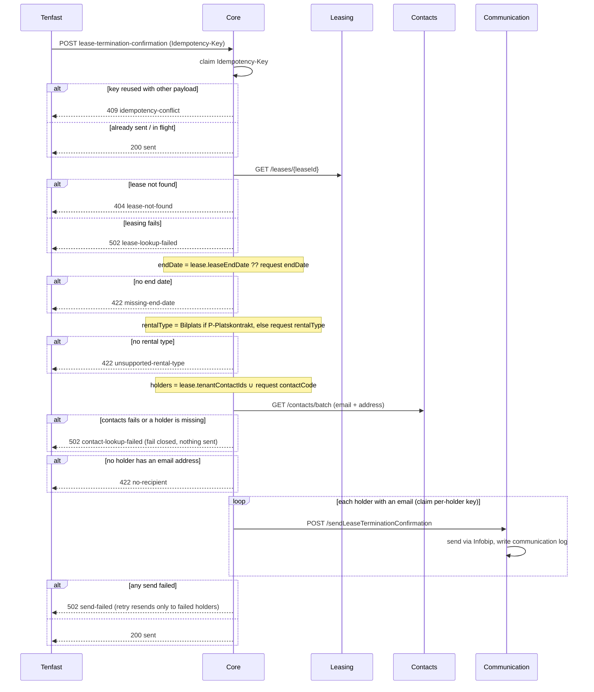

# Lease termination confirmation

Tenfast calls `POST /v1/tenant-notifications/lease-termination-confirmation`
after a parking lease termination is confirmed. OneCore enriches the
notification from the lease and the contacts service and emails every lease
holder through the communication service (Infobip template
`LeaseTerminationConfirmationTemplateId`).

Only `leaseId` is required. The other fields Tenfast already sends stay
accepted (all optional) so its integration keeps working unchanged:

| Field           | Use                                                 |
| --------------- | --------------------------------------------------- |
| `leaseId`       | Required. The lease to confirm.                     |
| `to`            | Ignored — recipients come from contacts.            |
| `firstName`     | Ignored — names come from contacts.                 |
| `contactCode`   | Added to the lease's holders as a recipient.        |
| `endDate`       | Fallback when the lease has no end date.            |
| `rentalType`    | Fallback when the lease is not a `P-Platskontrakt`. |
| `correlationId` | Stored in the communication log.                    |

## Template placeholders

Each holder gets their own email; every email lists all holders in lease order.

| Placeholder                | Value                                                          |
| -------------------------- | -------------------------------------------------------------- |
| `{{firstName}}`            | Recipient's first name (organisation: name)                    |
| `{{lastName}}`             | Recipient's last name                                          |
| `{{leaseId}}`              | Lease id                                                       |
| `{{endDate}}`              | Lease end date, `YYYY-MM-DD`                                   |
| `{{preferredMoveOutDate}}` | Preferred move-out date, empty if unset                        |
| `{{rentalObjectAddress}}`  | Address of the terminated rental object                        |
| `{{type}}`                 | Rental type (`Bilplats`)                                       |
| `{{tenantNName}}`          | Holder N full name                                             |
| `{{tenantNBirthDate}}`     | Holder N birth date `YYYY-MM-DD` (never the full personnummer) |
| `{{tenantNAddress}}`       | Holder N street (invoice address)                              |
| `{{tenantNPostalCode}}`    | Holder N postal code                                           |
| `{{tenantNCity}}`          | Holder N city                                                  |

`N` is 1, 2, …. Slots 1 and 2 are always present; an unused slot is empty.
