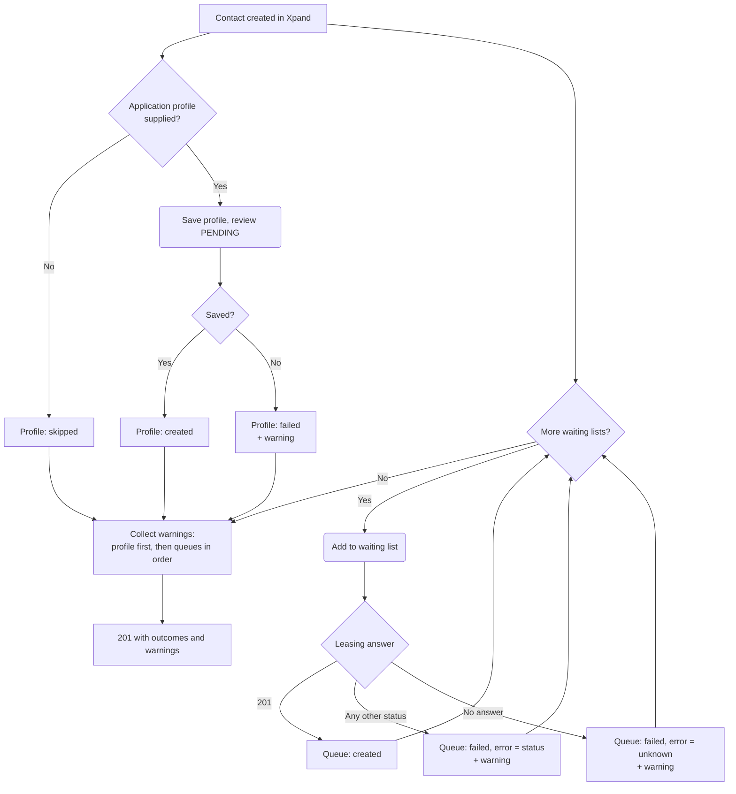
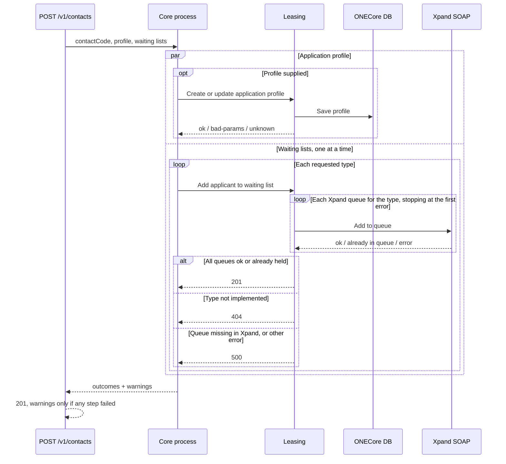

# Boendeprofil och köer för en ny kontakt

`setUpNewContactProfileAndWaitingLists` i [`new-contact-profile-and-waiting-lists.ts`](./new-contact-profile-and-waiting-lists.ts) körs direkt efter att en kontakt har skapats i Xpand. Den sparar hushållsuppgifterna (boendeprofilen) och ställer kontakten i de köer som valts. Anropas av `POST /v1/contacts` (property-tree) och av registreringen på Mina sidor ([`DOCS_Register_Applicant.md`](./DOCS_Register_Applicant.md)). Registreringen använder utfallen men inte de svenska varningstexterna, som är skrivna för handläggare; den gör om dem till varningskoder.

Kontakten går inte att ta bort när den väl finns, så processen misslyckas aldrig som helhet. Varje steg rapporterar sitt eget utfall, och varje misslyckat steg ger en varning på svenska till handläggaren. Routen svarar alltid 201.

Bara för en helt ny kontakt: profilen skrivs som ny med referensen i `PENDING`. Körs den för en kontakt vars boendereferens redan har granskats skrivs granskningen över. Ett misslyckat steg kompletteras i efterhand via endpoints för boendeprofil och kö, inte genom att köra processen igen.

## Flödesdiagram

Boendeprofilen och köerna körs samtidigt. Köerna körs en i taget, i den ordning de begärdes.

## Sekvensdiagram

Vilka Xpand-köer en kötyp omfattar avgörs av leasing: Bostad ger Bostad, Nyproduktion, Kooperativ och Ungdom. Bilplats och Förråd ger intern och extern. En kö kontakten redan står i räknas som lyckad.

