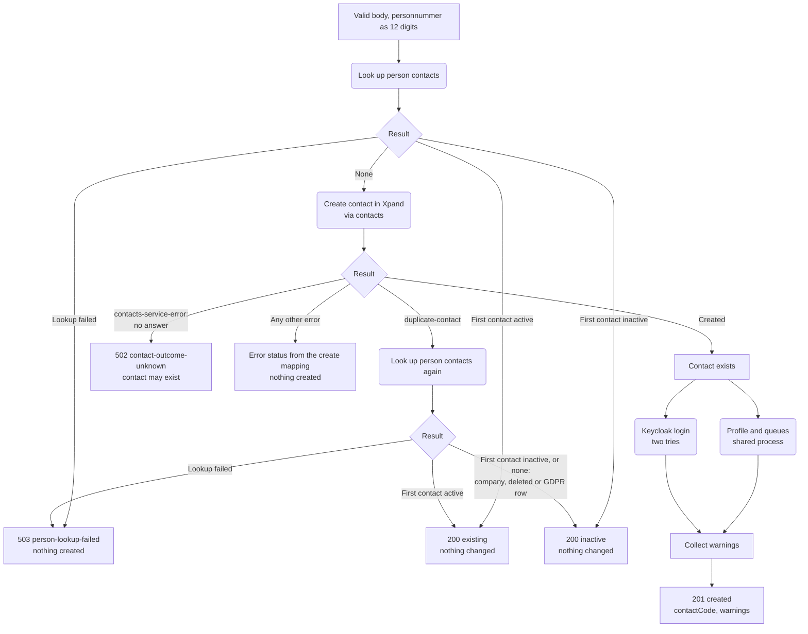
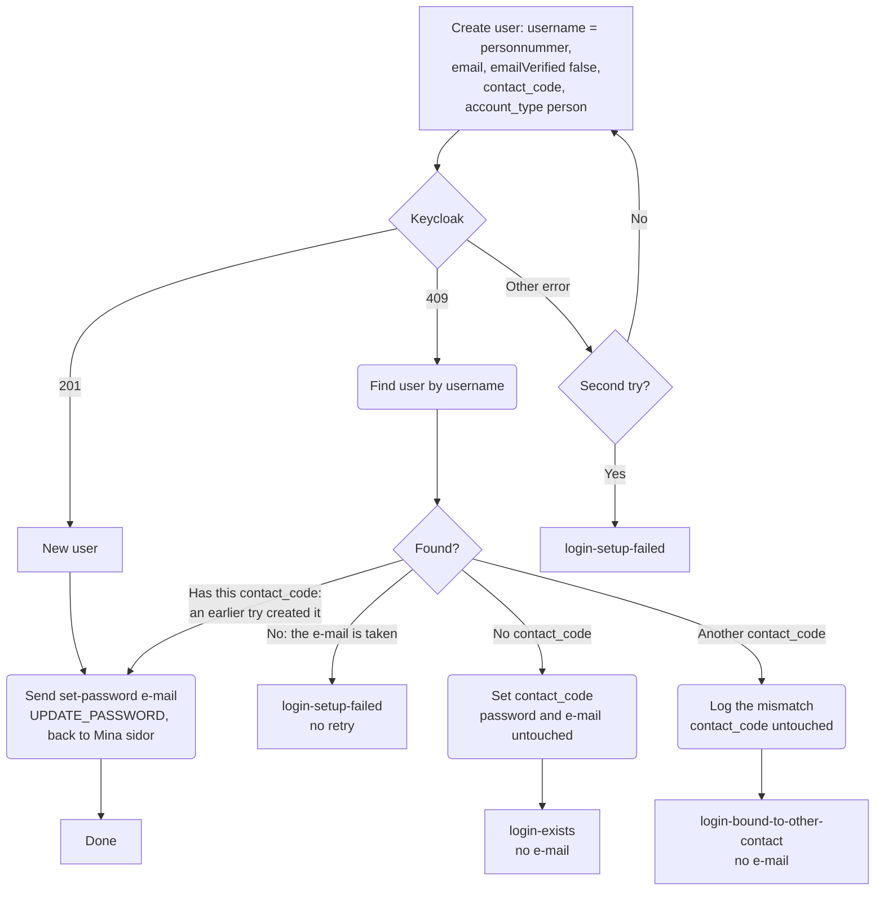

# Registrering av ny sökande

`registerApplicant` i [`register-applicant.ts`](./register-applicant.ts) registrerar en ny sökande från Mina sidor. Den anropas av `POST /auth/contacts/register` ([`contacts-registration-route.ts`](../../services/auth-service/contacts-registration-route.ts)), som webapi anropar med rollen `contacts:register`.

Registreringen skapar kontakten, sparar boendeprofilen, ställer kontakten i köerna och skapar inloggningen i Keycloak-realmen `mimer-contacts` med ett mejl där personen väljer lösenord. Ett lösenord passerar aldrig Mina sidor, webapi eller core.

Två regler styr allt:

- **Aldrig en andra kontakt för ett personnummer.** Finns personen redan rörs ingenting, inte heller i Keycloak.
- **Inte transaktionell.** Kontakten skapas i Xpand och går inte att ta bort. När den väl finns blir svaret alltid `created`, och varje senare steg som misslyckas blir en varning.

## Före processen: routen

Routen gör det som kan avgöras utan att fråga någon annan tjänst, innan något skapas:

| Kontroll                                                                                     | Svar                                                        |
| -------------------------------------------------------------------------------------------- | ----------------------------------------------------------- |
| Keycloak-URL, realm, mina-sidor-klienten, provisioning-klienten eller `minaSidor.url` saknas | 503 `registration-not-configured`                           |
| Kroppen följer inte schemat                                                                  | 400 `invalid-request` med fältnamnen, aldrig det som skrevs |
| Inte ett giltigt personnummer eller samordningsnummer                                        | 422 `invalid-national-id`                                   |
| Fyller inte 16 i år                                                                          | 422 `too-young`                                             |

Åldersregeln går på födelseår, inte exakt ålder: man får registrera sig från det kalenderår man fyller 16, som Mina sidor alltid har lovat. Året räknas i svensk tid, inte i containerns UTC. Processen skapar kontakten med `ageRule: 'birth-year'`, så contacts-tjänsten använder samma regel, också den i svensk tid. Skapa från property-tree behåller exakt 16 år.

Personnumret normaliseras till tolv siffror med `toContactsUsername`, samma form och samma funktion som Keycloak-användarnamnet läses med vid inloggning.

## Flödesdiagram

`contact-outcome-unknown` betyder att contacts-tjänsten aldrig svarade, till exempel vid en timeout, eller svarade med något okänt. Tjänsten kan ha skapat kontakten ändå. Ett nytt försök skulle svara `existing` för någon som saknar profil, köer och inloggning, så webapi ska skicka personen till kundtjänst i stället för att be dem försöka igen. Tvetydiga svar från Xpand (`xpand-unavailable`, `xpand-malformed-response`) reder contacts-tjänsten själv ut genom att slå upp numret igen. Når de core fanns ingen kontakt.

`duplicate-contact` betyder att contacts dubblettkontroll hittade en rad med numret, som matchar alla rader, även raderade och företag. Antingen registrerade någon numret precis innan (ett dubbelklick), eller så är raden ingen personkontakt. Felets `detail` innehåller den befintliga kontaktkoden och lämnar aldrig processen.

## Keycloak-inloggningen

- **En befintlig användare får aldrig mejlet.** Annars kunde vem som helst ta över ett konto genom att skriva sin egen e-post i formuläret. Svaret får varningen `login-exists`, så att webapi inte ber personen leta efter ett mejl som aldrig kommer.
- **En befintlig kontaktkod byts aldrig här**, av samma skäl: formuläret ska inte kunna flytta någon annans inloggning till en ny kontakt. Skillnaden loggas och svaret får varningen `login-bound-to-other-contact`. Reparationen vid inloggning löser det inte: den byter bara en kod som inte går att slå upp, och borttagna eller GDPR-rensade kontakter går fortfarande att slå upp. Den gamla kontakten kan inte ha personnumret, för då hade skapandet nekats, men inloggningen visar den tills någon ändrar koden för hand.
- **Ett nytt försök skapar inte användaren igen.** Användar-id:t sparas mellan försöken, så bara steget som föll görs om.
- **En användare med just den här kontaktkoden** skapades av ett försök som aldrig fick svar, till exempel vid en timeout. Den räknas som ny och får mejlet.

## Varningar

| Varning                        | Orsak                                                                                             | Hur personen kommer vidare                                                                                                                                  |
| ------------------------------ | ------------------------------------------------------------------------------------------------- | ----------------------------------------------------------------------------------------------------------------------------------------------------------- |
| `application-profile-failed`   | Boendeprofilen sparades inte                                                                      | Fyller i den under Mina sidor                                                                                                                               |
| `waiting-lists-failed`         | Minst en kö lades inte till                                                                       | Väljer köer under Mina sidor                                                                                                                                |
| `login-setup-failed`           | Ingen Keycloak-användare eller inget mejl efter två försök                                        | Kundtjänst, eller nattkörningen som skapar användaren. En ny registrering svarar `existing`. Finns användaren men mejlet uteblev fungerar "Glömt lösenord". |
| `login-exists`                 | Det fanns redan en inloggning för personnumret, så inget mejl skickades                           | Loggar in, eller använder "Glömt lösenord" om lösenord aldrig valts                                                                                         |
| `login-bound-to-other-contact` | Inloggningen för personnumret hör till en annan kontakt och behåller den, så inget mejl skickades | Kundtjänst. Inloggningen skulle visa den gamla kontakten, inte den nya                                                                                      |

## Uppslagningen av personkontakter

Processen frågar contacts-tjänsten (`GET /contacts/by-nid/:nid/person-contacts`) efter alla personkontakter för personnumret: P-koder som inte är raderade, med numret lagrat i någon av formerna. Företag och raderade kontakter räknas inte, men dubblettkontrollen vid skapandet hittar dem ändå.

Kontakterna kommer i den ordning inloggningen rangordnar dem, och var och en är markerad aktiv eller inaktiv. Aktiv betyder att kontaktens Sökande-roll används, vilket webapi kräver för att släppa in personen.

**Den första kontakten avgör.** Inloggningen använder bara den, och nekar den om den är inaktiv. Är den aktiv svarar registreringen `existing`, annars `inactive`. En aktiv kontakt längre ner hjälper inte: att be personen logga in skulle bara sluta med ett nej.

Svarar tjänsten inte, eller med något oväntat, blir svaret 503 `person-lookup-failed` och ingenting skapas.

## Loggning

Personnummer, e-post och kroppen loggas aldrig. Loggarna innehåller kontaktkoden, utfall och varningar, och för Keycloak-fel bara HTTP-status och felkod.
