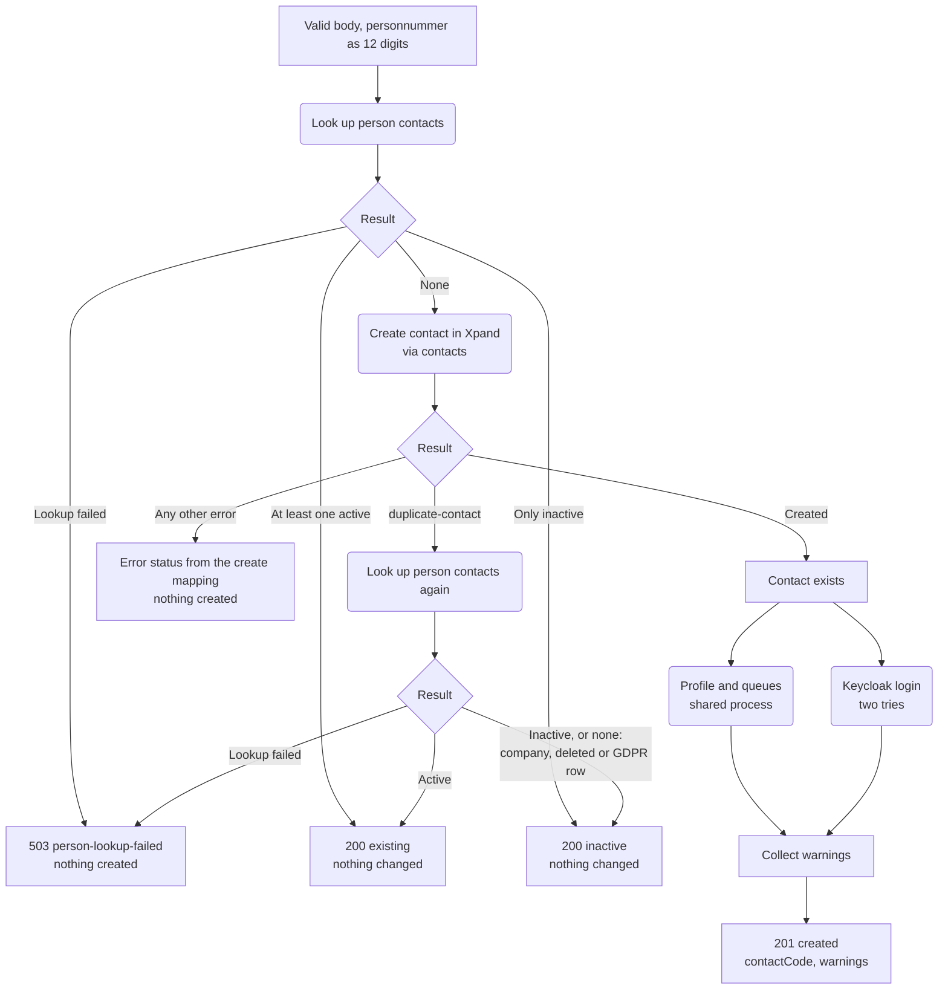
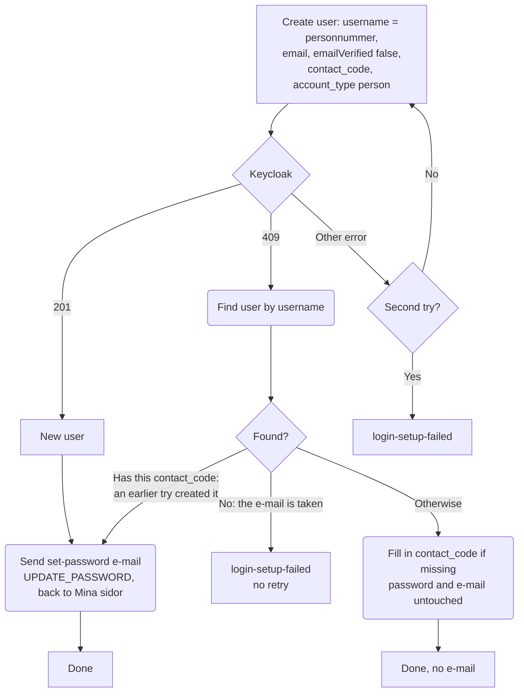

# Registrering av ny sökande

`registerApplicant` i [`register-applicant.ts`](./register-applicant.ts) registrerar en ny sökande från Mina sidor. Den anropas av `POST /auth/contacts/register` ([`contacts-registration-route.ts`](../../services/auth-service/contacts-registration-route.ts)), som webapi anropar med rollen `contacts:register`.

Registreringen skapar kontakten, sparar boendeprofilen, ställer kontakten i köerna och skapar inloggningen i Keycloak-realmen `mimer-contacts` med ett mejl där personen väljer lösenord. Ett lösenord passerar aldrig Mina sidor, webapi eller core.

Två regler styr allt:

- **Aldrig en andra kontakt för ett personnummer.** Finns personen redan rörs ingenting, inte heller i Keycloak.
- **Inte transaktionell.** Kontakten skapas i Xpand och går inte att ta bort. När den väl finns blir svaret alltid `created`, och varje senare steg som misslyckas blir en varning.

## Före processen: routen

Routen gör det som kan avgöras utan att fråga någon annan tjänst, innan något skapas:

| Kontroll                                               | Svar                                                        |
| ------------------------------------------------------ | ----------------------------------------------------------- |
| Keycloak-URL, realm eller provisioning-klienten saknas | 503 `registration-not-configured`                           |
| Kroppen följer inte schemat                            | 400 `invalid-request` med fältnamnen, aldrig det som skrevs |
| Inte ett giltigt personnummer eller samordningsnummer  | 422 `invalid-national-id`                                   |
| Fyller inte 16 i år                                    | 422 `too-young`                                             |

Åldersregeln går på födelseår, inte exakt ålder: man får registrera sig från det kalenderår man fyller 16, som Mina sidor alltid har lovat. Contacts-tjänsten kräver fortfarande exakt 16 år när kontakten skapas, så den som fyller 16 senare i år får `invalid-national-id` från den tills tjänsten låter anroparen välja regel.

Personnumret normaliseras till tolv siffror, samma form som Keycloak-användarnamnet.

## Flödesdiagram

`duplicate-contact` betyder att contacts dubblettkontroll hittade en rad med numret, som matchar alla rader, även raderade och företag. Antingen registrerade någon numret precis innan (ett dubbelklick), eller så är raden ingen personkontakt. Felets `detail` innehåller den befintliga kontaktkoden och lämnar aldrig processen.

## Keycloak-inloggningen

- **En befintlig användare får aldrig mejlet.** Annars kunde vem som helst ta över ett konto genom att skriva sin egen e-post i formuläret.
- **Ett nytt försök skapar inte användaren igen.** Användar-id:t sparas mellan försöken, så bara steget som föll görs om.
- **En användare med just den här kontaktkoden** skapades av ett försök som aldrig fick svar, till exempel vid en timeout. Den räknas som ny och får mejlet.

## Varningar

| Varning                      | Orsak                                                      | Hur personen kommer vidare                                                                                                                                  |
| ---------------------------- | ---------------------------------------------------------- | ----------------------------------------------------------------------------------------------------------------------------------------------------------- |
| `application-profile-failed` | Boendeprofilen sparades inte                               | Fyller i den under Mina sidor                                                                                                                               |
| `waiting-lists-failed`       | Minst en kö lades inte till                                | Väljer köer under Mina sidor                                                                                                                                |
| `login-setup-failed`         | Ingen Keycloak-användare eller inget mejl efter två försök | Kundtjänst, eller nattkörningen som skapar användaren. En ny registrering svarar `existing`. Finns användaren men mejlet uteblev fungerar "Glömt lösenord". |

## Uppslagningen av personkontakter

`lookupPersonContacts` i [`person-contacts-lookup.ts`](./person-contacts-lookup.ts) ska ge alla personkontakter för ett personnummer, var och en markerad aktiv eller inaktiv. Personkontakt betyder en P-kod som inte är mjukraderad och inte en GDPR-rad.

**Den är inte byggd än.** Contacts-tjänsten saknar en sådan uppslagning, och vad "aktiv" betyder i Xpand utreds fortfarande. Tills den finns svarar den `not-implemented`, och registreringen svarar 503 `person-lookup-failed` utan att skapa något, i stället för att gissa vem som är aktiv.

## Loggning

Personnummer, e-post och kroppen loggas aldrig. Loggarna innehåller kontaktkoden, utfall och varningar, och för Keycloak-fel bara HTTP-status och felkod.
