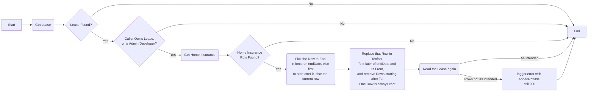
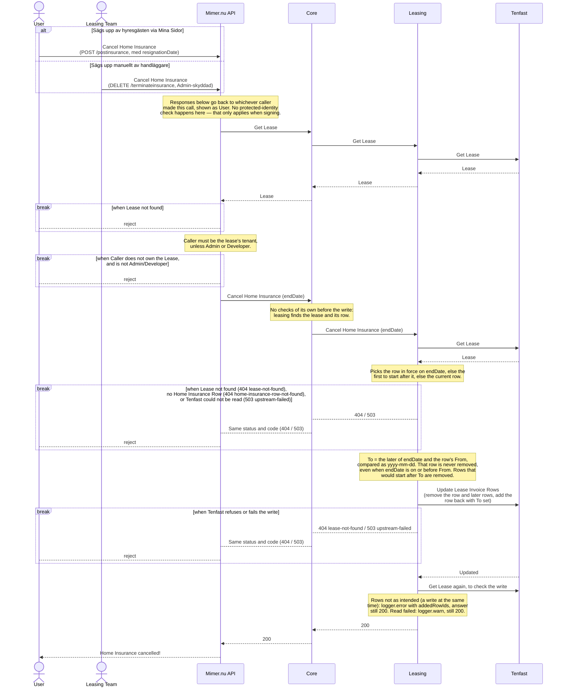
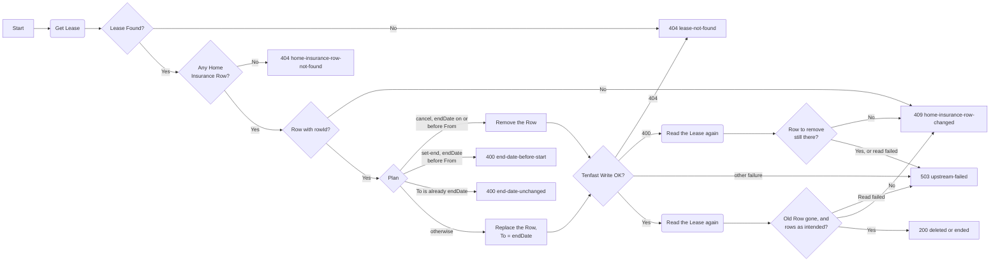

# Säg upp Hemförsäkring

_Del av [processöversikten](./DOCS_Overview.md) för hemförsäkring._

En hemförsäkring avslutas från ett visst datum — antingen av hyresgästen själv via Mina Sidor, eller manuellt av en handläggare via en Admin-skyddad endpoint i Mimer.nu API. Ingen anropare av den handläggarvägen hittades i de undersökta kodbaserna — den används sannolikt manuellt (t.ex. via Swagger) snarare än från ett byggt gränssnitt. Se [Teckna Hemförsäkring](./DOCS_Sign_Home_Insurance.md) för motsatta vägen.

## Flödesdiagram

Processens beslutslogik: vilka kontroller som styr om flödet går vidare till nästa steg, och vad som händer vid godkännande, nekande eller fel. System- och integrationsdetaljer är medvetet utelämnade här — se sekvensdiagrammet nedan för det.

## Sekvensdiagram

Vilka tjänster och externa system som anropas i varje steg, i vilken ordning, och var processen kan avbrytas vid en misslyckad kontroll. Täcker båda ingångarna (hyresgästens självbetjäning och det manuella Admin-anropet). Mimer.nu API behandlas som en extern aktör (se [processöversikten](./DOCS_Overview.md)) — bara dess relevanta affärsregler och anrop mot OneCore ritas ut.

## Regler i leasing

- **Vilken rad som gäller.** Ett kontrakt kan ha flera hemförsäkringsrader, till exempel en avslutad och en ny, eller en rad som slutar och en som tar över efter den (vid en prisändring). För status väljer leasing raden som gäller i dag, annars nästa kommande, annars den senast avslutade. Har den valda raden ett T.o.m. och en tillsvidarerad börjar efter det, väljs den raden, eftersom försäkringen fortsätter (`selectCurrentHomeInsuranceRow` i `services/leasing/src/services/lease-service/services/home-insurance.ts`). Tidigare togs den första raden med artikeln, vilket kunde vara en gammal avslutad rad. Samma val används av GET och [LF-exporten](./DOCS_Export_Home_Insurance_to_Lansforsakringar.md).
- **Återbetalningsrader.** Xpand använde en extra rad med samma artikel och negativt belopp för återbetalning, och importerade kontrakt kan ha kvar sådana. De räknas aldrig som försäkringen och lämnas orörda vid uppsägning. Nya återbetalningar i Tenfast bör få en egen artikel.
- **Vilka rader uppsägningen skriver.** Raden som gäller på `endDate` får `endDate` som T.o.m., och rader som skulle börja efter det tas bort, så att en rad som tar över senare inte fortsätter att debiteras (`planHomeInsuranceCancel`). Sådana rader kommer från Xpand, där en premiehöjning gav en ny rad; i Tenfast höjs priset på samma rad. Att ta bort dem i stället för att avsluta dem påverkar varken faktureringen eller LF-exporten (avstämt med hyresadministrationen). Gäller ingen rad på `endDate` avslutas den första raden som börjar efter `endDate` på sin egen Fr.o.m., och senare rader tas bort. Finns ingen sådan heller avslutas raden som gäller nu på `endDate`, som förut.
- **Slutdatum före startdatum.** `to` blir det senare av `endDate` och radens `from`. En rad som slutar innan den börjar uppstår alltså inte längre. Säger hyresgästen upp på eller före startdagen blir raden kvar med Fr.o.m. = T.o.m.
- **Samtidig ändring av samma rad.** Har någon annan redan ersatt raden (till exempel personal) avvisar Tenfast hela skrivningen med 400 och skriver ingenting. Leasing läser då om kontraktet, ser att raden är borta och svarar 409 `home-insurance-row-changed`. Hyresgästen kan försöka igen.
- **Kontroll efter skrivningen.** Leasing läser om kontraktet efter skrivningen, lägger det i listans minne och jämför raderna med vad skrivningen skulle lämna. Skiljer de sig, för att någon lade till en rad samtidigt, loggas `logger.error` med `leaseId` och `addedRowIds`. Svaret är ändå 200, eftersom skrivningen gick igenom. Teckna gör samma kontroll.
- **En rad behålls alltid här.** Mina sidor (`HomeInsuranceForm.vue`) visar ett kommande kontrakt utan hemförsäkringsrad som försäkrat och erbjuder "Säg upp" igen. Att ta bort raden från den här vägen kräver en samtidig ändring i Mina sidor och är ett separat kort. Borttagning finns bara i personalens PATCH (nedan).
- **Datum.** Mimer.nu skickar `endDate` som `"2026-12-01T00:00:00"` utan tidszon. Leasing gör om det till en dag (`yyyy-mm-dd`) på samma sätt som förut och jämför sedan dagar som strängar, aldrig som `Date`.
- **Svar.** 200 när skrivningen lyckats (`content: null`), eftersom Mina sidor inte klarar något annat. Fel ges som typade koder i `error`: 400 för ogiltig body, 404 `lease-not-found` eller `home-insurance-row-not-found`, 409 `home-insurance-row-changed` när raden ändrades av någon annan före skrivningen, och 503 `upstream-failed` när Tenfast inte kunde läsas eller skrivas. Tidigare blev felen 500.
- **Core.** Core-routen `POST /leases/{leaseId}/home-insurance/cancel` gör inga egna kontroller före skrivningen (tidigare hämtade den kontraktet och raden först). Den skickar leasings fel vidare med samma status och kod, med `{ error, reason }`. Ett oväntat svar eller inget svar från leasing ger 500 `unknown`.

## Personal: avsluta eller ändra T.o.m. (leasing)

`PATCH /leases/{leaseId}/home-insurance/rows/{rowId}` i leasing, med body `{ endDate: "yyyy-mm-dd", action: "cancel" | "set-end" }`. `rowId` är raden som klienten senast läste, från `GET /leases/{leaseId}/home-insurance`. Personal når den via core-routen med samma sökväg, som kräver rollen `home-insurance:write`. Se [Personalens hemförsäkringsverktyg](./DOCS_Staff_Home_Insurance.md).

- **Borttagning.** `cancel` med `endDate` på eller före radens `from` tar bort raden, eftersom försäkringen då aldrig gäller. Svaret är `{ action: "deleted", row: null }`. Annars ersätts raden av en kopia med nytt `to`, och svaret är `{ action: "ended", row }` med radens nya `rowId`. Tas en rad bort på ett _kommande_ kontrakt visar Mina sidor hyresgästen som försäkrad (se ovan).
- **Skrivningen avgör racet, inte en förkontroll.** Tenfast avvisar hela skrivningen med 400 när en rad i `rowsToDelete` redan är borta, och skriver då ingenting (verifierat mot Tenfast test). Felet saknar egen kod, så leasing tolkar inte texten utan läser om kontraktet: är raden borta blir svaret 409 `home-insurance-row-changed`, annars är 400 ett riktigt fel och svaret 503 `upstream-failed`. Två skrivningar på samma rad kan alltså aldrig ge en dubblett.
- **Kontroll efter skrivningen.** Efter en lyckad skrivning läser leasing om kontraktet och kräver att den gamla raden är borta och att hemförsäkringsraderna är exakt de som fanns före plus den skrivna (ingen vid borttagning). Annars, till exempel om någon lade till en rad samtidigt, blir svaret 409, och kan kontraktet inte läsas om blir det 503. Båda loggas med `logger.error`, 409 med `addedRowIds`. Svaret blir aldrig 200 utan att skrivningen kontrollerats.
- **Ny rad, nytt id, samma `includeInContract`.** Ersättningsraden får ett nytt `_id`, och hyran ändras inte. Tenfast sätter `includeInContract` till `false` på en rad utan fältet, så kopian får originalradens värde.
