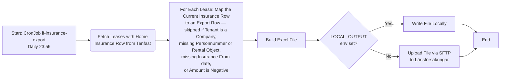
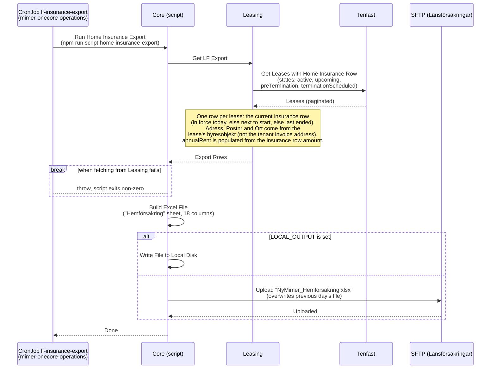

# Exportera Hemförsäkring till Länsförsäkringar

_Del av [processöversikten](./DOCS_Overview.md) för hemförsäkring._

Ett fristående script (`core/src/scripts/home-insurance-export.ts`) hämtar samtliga hyreskontrakt med en hemförsäkringsrad i Tenfast — i statusarna `active`, `upcoming`, `preTermination` och `terminationScheduled` — och skickar en daglig Excel-fil med dem till Länsförsäkringar via SFTP. Det här är ett annat exportflöde än mimer.nu:s eget (se [processöversiktens](./DOCS_Overview.md) avsnitt "Utanför denna dokumentation") — den här exporten läser från Tenfast, inte från mimer.nu:s lokala databas.

Schemaläggningen ligger inte i onecore-repot utan i `mimer-onecore-operations` (`apps/onecore/core/lfinsuranceexportcronjob.yaml`) — ett Kubernetes CronJob vid namn `lf-insurance-export` som kör `npm run script:home-insurance-export` i core-imagen, dagligen kl 23:59 (`59 23 * * *`).

## Vilken rad som exporteras

Ett kontrakt kan ha flera hemförsäkringsrader, till exempel en avslutad rad och en ny. Exporten tar en rad per kontrakt: den som gäller i dag, annars nästa kommande, annars den senast avslutade (`selectCurrentHomeInsuranceRow` i leasing, samma val som GET använder). Har den raden ett T.o.m. och en tillsvidarerad börjar efter det, till exempel efter en prisändring, tas den raden i stället: försäkringen fortsätter, så kontraktet får `G` (eller `K`) och inte `*`. Statusen `G`/`K`/`*`, Fr.o.m./T.o.m. och beloppet kommer från den valda raden.

**Ändring i AVTAL-526:** tidigare tog exporten den första raden med artikeln, vilket kunde vara en gammal avslutad rad. Kontrakt där en avslutad rad låg före den gällande raden fick då status `*` och fel datum i filen. Nu får de den gällande radens status och datum, så filen till Länsförsäkringar kan skilja sig från tidigare dagars filer för just de kontrakten. Samma gäller kontrakt där en rad slutar och en tillsvidarerad tar över: de fick tidigare `*`, nu `G` med den nya radens datum och belopp.

Personalens lista över hemförsäkringar (leasings `GET /leases/home-insurances?rows=lf`) väljer kontrakt och rad på samma sätt som exporten (`selectLfRows` i `lf-export.ts`), men utan personuppgifter. Den som ändrar urvalet för filen ändrar alltså listan också. Exporten läser alltid direkt från Tenfast, aldrig från listans cache.

## Flödesdiagram

Processens beslutslogik: vilka steg som körs, och vilka rader som filtreras bort vid mappning. System- och integrationsdetaljer är medvetet utelämnade här — se sekvensdiagrammet nedan för det.

## Sekvensdiagram

Vilka tjänster som anropas i varje steg, i vilken ordning. Detta är ett fristående script i core-paketet, inte en HTTP-endpoint — det körs utanför Koa-servern, som ett eget engångs-Kubernetes-Job skapat av CronJobbet, utan mänsklig initierare.

