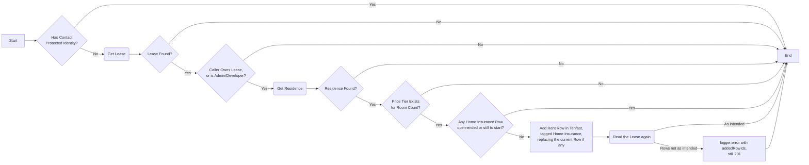
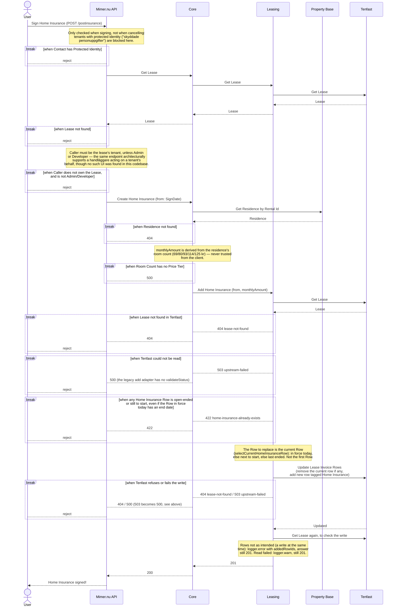

# Teckna Hemförsäkring

_Del av [processöversikten](./DOCS_Overview.md) för hemförsäkring._

En hyresgäst tecknar hemförsäkring för sin lägenhet via Mina Sidor. Mimer.nu API kontrollerar att hyresgästen äger kontraktet och inte har skyddade personuppgifter, varpå OneCore beräknar priset utifrån lägenhetens rumsantal och lägger till en hyresrad i Tenfast, taggad som hemförsäkring. Se [Säg upp Hemförsäkring](./DOCS_Cancel_Home_Insurance.md) för motsatta vägen.

## Flödesdiagram

Processens beslutslogik: vilka kontroller som styr om flödet går vidare till nästa steg, och vad som händer vid godkännande, nekande eller fel. System- och integrationsdetaljer är medvetet utelämnade här — se sekvensdiagrammet nedan för det.

## Sekvensdiagram

Vilka tjänster och externa system som anropas i varje steg, i vilken ordning, och var processen kan avbrytas vid en misslyckad kontroll. Mimer.nu API behandlas som en extern aktör (se [processöversikten](./DOCS_Overview.md)) — bara dess relevanta affärsregler och anrop mot OneCore ritas ut.

## Regler i leasing

- **Redan försäkrad.** Leasing svarar 422 `home-insurance-already-exists` när någon hemförsäkringsrad saknar slutdatum eller ännu inte har börjat (`hasOpenOrUpcomingHomeInsuranceRow`). Tidigare tittade leasing bara på den första raden med artikeln, och sedan bara på den rad som gäller i dag. En rad som slutar med en tillsvidarerad efter sig gav då en ny rad bredvid den, och hyresgästen debiterades två gånger.
- **Vilken rad som ersätts.** Finns en rad som slutar (uppsagd) ersätts raden som gäller nu (`selectCurrentHomeInsuranceRow`), inte den första raden med artikeln.
- **Fel.** Leasing svarar med typade koder: 404 `lease-not-found` och 503 `upstream-failed` när Tenfast inte kunde läsas eller skrivas. Core-adaptern för teckning (`addLeaseHomeInsurance`) har ingen `validateStatus` och mappar inte koderna, så 503 blir ett axios-fel och 500 i core. Att flytta den till de typade felen, som GET och cancel redan använder, är ett separat kort: svaret till Mina sidor ändras då.
- **Kontroll efter skrivningen.** Som vid uppsägning läser leasing om kontraktet efter skrivningen och loggar `addedRowIds` om raderna inte blev som skrivningen skulle lämna. Se [Säg upp Hemförsäkring](./DOCS_Cancel_Home_Insurance.md#regler-i-leasing).
