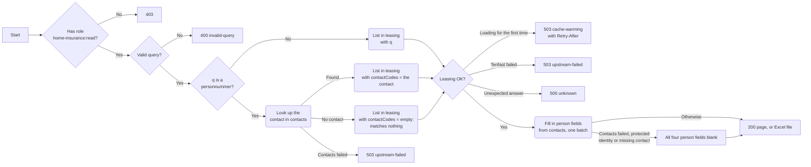
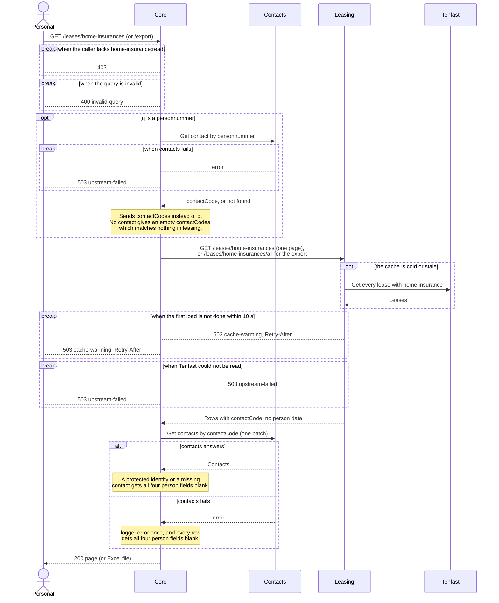
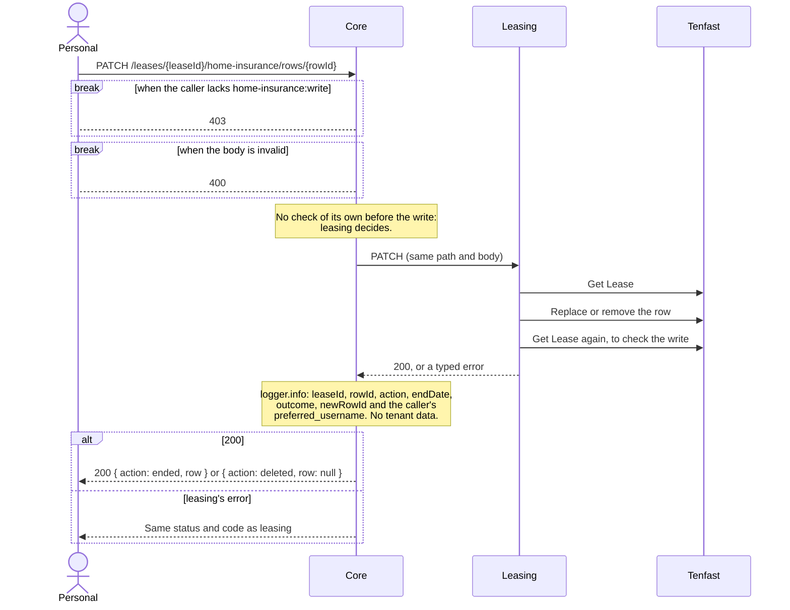

# Personalens hemförsäkringsverktyg

_Del av [processöversikten](./DOCS_Overview.md) för hemförsäkring._

Personal kan lista alla hemförsäkringsrader, exportera listan till Excel och avsluta eller ändra T.o.m. på en enskild rad. Allt går via core. Leasing äger raderna (Tenfast) och contacts äger persondata. Core lägger ihop dem och styr åtkomsten med två roller.

| Route i core                                          | Roll                   | Vad den gör                                             |
| ----------------------------------------------------- | ---------------------- | ------------------------------------------------------- |
| `GET /leases/home-insurances`                         | `home-insurance:read`  | En sida av listan, med persondata från contacts         |
| `GET /leases/home-insurances/export`                  | `home-insurance:read`  | Hela urvalet som Excel, i LF-filens 18 kolumner         |
| `PATCH /leases/{leaseId}/home-insurance/rows/{rowId}` | `home-insurance:write` | Avslutar eller tar bort raden, eller ändrar dess T.o.m. |

Rollerna ges inte via `api-access` (`core/src/middlewares/route-roles.ts`). Annars skulle alla med en api-access-token kunna läsa hyresgästernas personnummer och avsluta försäkringar. Rollerna måste finnas i Keycloak i dev, test och prod och tilldelas personal före release. Den som ska avsluta rader behöver båda rollerna, eftersom listan kräver `home-insurance:read`.

## Lista och export

### Flödesdiagram

### Sekvensdiagram

### Regler

- **Persondata bara från contacts.** Leasings lista har bara `contactCode`. Namn, personnummer (organisationsnummer för företag), telefon och e-post hämtas från contacts i en batch per sida, och för exporten i en batch för hela urvalet (`withHomeInsuranceContacts` i `core/src/services/lease-service/helpers/home-insurance.ts`). Felar contacts, har kontakten skyddad identitet eller saknas kontakten blir alla fyra fälten tomma. Hyresgästens namn från Tenfast används aldrig, därför används inte `enrichLeaseContacts` här.
- **Sökning på personnummer.** Ett personnummer i `q` slås upp i contacts (`resolvePersonnummer`) och skickas som `contactCodes`. Saknas kontakten blir listan tom. Felar uppslaget blir svaret 503 `upstream-failed`, aldrig en lista som inte hör till personen. Annan text skickas som `q` och matchar kontraktsnummer, objektsnummer, kundnummer och objektets adress. Sökning på namn finns inte än: leasing har inga namn, och contacts namnsökning kan inte kombineras med leasings fritextsökning.
- **Klientens `contactCodes` ignoreras.** Bara core sätter den.
- **Sidlänkar.** Core bygger `_links` själv, med frågan som klienten skickade (personnumret, inte kundnumret det gav).
- **Excel.** Exporten har samma 18 kolumner i samma ordning som filen till Länsförsäkringar. Kolumnerna definieras på ett ställe (`HOME_INSURANCE_LF_COLUMNS` i `core/src/processes/reports/converters/home-insurance-columns.ts`), som också `convertHomeInsuranceToXlsx` använder. Kolumnen med månadsbeloppet heter Årshyra, som i LF-filen. Exporten hämtar hela urvalet i ett anrop (`GET /leases/home-insurances/all` i leasing), ur en och samma läsning av leasings minne. Sida för sida kunde raderna komma från olika poddar eller laddningar, så att en rad saknades eller kom två gånger.
- **Inga persondata i loggen.** Loggarna i routerna har bara namngivna fält. `metadata` loggas aldrig, eftersom dess `_links.self.href` är hela URL:en, och `q` kan vara ett personnummer.
- **Lista och LF-fil.** `rows=lf` ger samma urval som LF-filen. Se [Exportera Hemförsäkring till Länsförsäkringar](./DOCS_Export_Home_Insurance_to_Lansforsakringar.md) och listans minne i `.claude/skills/tenfast-integration.md`.

## Avsluta eller ändra T.o.m.

`PATCH /leases/{leaseId}/home-insurance/rows/{rowId}` med body `{ endDate: "yyyy-mm-dd", action: "cancel" | "set-end" }`. `rowId` är raden som klienten senast läste, från listan eller från `GET /leases/{leaseId}/home-insurance`.

Core skickar leasings fel vidare 1:1, med `{ error, reason }`:

| Status | `error`                                           | När                                                                                                                |
| ------ | ------------------------------------------------- | ------------------------------------------------------------------------------------------------------------------ |
| 400    | `end-date-before-start`, `end-date-unchanged`     | `set-end` före radens Fr.o.m., eller T.o.m. är redan `endDate`                                                     |
| 404    | `lease-not-found`, `home-insurance-row-not-found` | Kontraktet saknas, eller det har ingen hemförsäkringsrad                                                           |
| 409    | `home-insurance-row-changed`                      | Raden med `rowId` finns inte längre (ingenting skrevs), eller någon annan ändrade raderna samtidigt. Läs om raden. |
| 503    | `upstream-failed`                                 | Tenfast kunde inte läsas eller skrivas, eller skrivningen kunde inte kontrolleras                                  |
| 500    | `unknown`                                         | Leasing svarade oväntat eller inte alls. Raden kan ha skrivits, så klienten ska läsa om den.                       |

En ogiltig body (till exempel ett datum som inte finns eller en okänd `action`) stoppas av cores `parseRequestBody` innan leasing anropas. Svaret är 400 utan felkod, i formen `{ status: 'error', data: [{ message, path }] }` (`InvalidRequestBodyResponse` i Swagger). Klienten känner igen det på att `error` saknas.

### Samtidiga skrivningar

Tenfast har ingen villkorad skrivning, men avvisar hela skrivningen med 400 när en rad som ska tas bort redan är borta (verifierat mot Tenfast test):

- **Samma rad ändras av två samtidigt.** Den som skriver sist får 409 `home-insurance-row-changed`, och ingenting skrivs. Det gäller personal mot personal och personal mot hyresgästen via Mina sidor. Läs om raden och försök igen. Någon dubblett uppstår inte.
- **Kontroll efter skrivningen.** Leasing läser om kontraktet efter varje lyckad skrivning och jämför raderna med vad skrivningen skulle lämna. Lade någon till en rad samtidigt blir svaret 409, och leasing loggar `logger.error` med `leaseId`, `rowId` och `addedRowIds`.
- **Mina sidor kontrollerar också.** Cancel och add gör samma kontroll och loggar samma fel, men svarar ändå 200 respektive 201, eftersom skrivningen gick igenom och Mina sidor kräver det. Det enda fall Tenfast inte kan stoppa är två samtidiga tecknanden på ett kontrakt utan hemförsäkringsrad; loggen pekar då ut raderna.

Reglerna för borttagning, kontrollen efter skrivningen och vad som är verifierat mot Tenfast test står i [Säg upp Hemförsäkring](./DOCS_Cancel_Home_Insurance.md#personal-avsluta-eller-ändra-tom-leasing).
