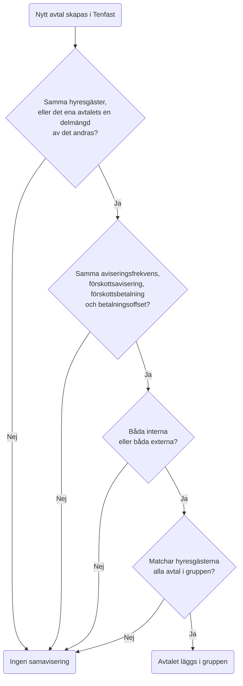

# Samavisering

_Del av [processöversikten](./DOCS_Overview.md) för fakturadistribution._

Samavisering betyder att flera avtal för samma hyresgäst hamnar på en och samma avi, till exempel en bostad och en bilplats. Det är Tenfast som sköter samaviseringen, helt automatiskt. OneCore skickar inget om samavisering när ett avtal skapas, varken från [Xpand-synken](../../scripts/sync-leases/DOCS_Sync_Leases.md), [Direkthyra av bilplats](../parkingspaces/external/DOCS_Create_Lease_for_None_Scored_Parking_Space.md) eller [accepterade erbjudanden](../parkingspaces/internal/DOCS_Accept_Offer.md).

Reglerna nedan kommer från Tenfast (2026-11-17).

## När två avtal samaviseras

Tenfast lägger ett nytt avtal i samma grupp som ett befintligt avtal när allt det här gäller:

- **Hyresgästerna matchar.** Antingen har avtalen exakt samma hyresgäster, eller så är det ena avtalets hyresgäster en delmängd av det andras. Det räcker inte med en gemensam hyresgäst.
- **Aviseringsinställningarna är lika:** `aviseringsFrekvens`, `forskottAvisering`, `betalasForskott` och `betalningsOffset`.
- **Båda är interna eller båda externa.** Ett internt avtal samaviseras aldrig med ett externt.

Hyresgästerna ska matcha mellan varje par av avtal i gruppen, inte bara mot det nya avtalet. Avtal med exakt samma hyresgäster prioriteras.

### Exempel

| Avtal                                           | Resultat                                                                                      |
| ----------------------------------------------- | --------------------------------------------------------------------------------------------- |
| Bostad med A och B, bilplats med A              | Samaviseras. A är en delmängd av A och B. Bostaden blir huvudavtal.                           |
| Bostad med A, bilplats med A och B              | Samaviseras. Delmängden kan gå åt båda hållen.                                                |
| Bostad med A och B, bilplats med A och C        | Ingen samavisering.                                                                           |
| Bostad med A och B, en bilplats med A, en med B | Alla tre hamnar inte i samma grupp, eftersom bilplatsernas hyresgäster inte matchar varandra. |

## När grupperingen sker

Avtalet läggs i gruppen när det skapas, inte när det signeras. Det gäller även ett osignerat avtal, till exempel en bilplats som väntar på signering i SimpleSign. Det spelar ingen roll om de befintliga avtalen är signerade.

Signeringen styr i stället vem som kan vara huvudavtal och vad som kommer med på avin:

- Bara ett signerat avtal kan vara huvudavtal. Ett avtal av typen bostad, bostadsrätt eller villa föredras.
- Huvudavtalets avi tar bara med signerade avtal i gruppen.
- När en bilplats signeras skapas dess hyror via gruppens huvudavtal, så bilplatsen kommer med på nästa avi.

## Att känna till

- **OneCore väljer aldrig grupp.** Tenfasts API har inget fält för att ange vilka avtal ett nytt avtal ska samaviseras med. Det enda som går att påverka är `disableAutoSamAvisering`, som stänger av samavisering för ett avtal. OneCore skickar inte det fältet, så samavisering är alltid på.
- **Aviseringsinställningarna måste stämma med de befintliga avtalen.** Både `createLease` och `importLease` i leasing skickar `aviseringsFrekvens: 1m`, `forskottAvisering: 2v`, `betalningsOffset: 1d` och `betalasForskott: true`. Ändras någon av dem i OneCore, eller på de befintliga avtalen i Tenfast, slutar nya avtal att samaviseras med gamla.
- **Det hände i november 2026.** Tenfast flyttade aviseringen till den 16:e och ändrade då `forskottAvisering` till `12d` på alla importerade avtal. Avtal som OneCore skapade efter det fick `2v` och samaviserades inte. Tenfast har ändrat tillbaka till `2v`, så avtal som skapas från och med 2026-11-17 samaviseras igen. Tenfast har ett ärende för att rätta de avtal som skapades under tiden.
- **`parentAvtal` har inget med samavisering att göra.** Fältet kopplar ett tilläggsavtal till sitt huvudavtal.
- **Huvudavtal vid Tenfasts engångsimport från Xpand.** I Xpand pekade samaviserade avtal ibland på ett upphört huvudavtal. Vid importen sattes huvudavtalet därför till bostadskontraktet, annars till det avtal som började gälla först (AVTAL-265). Det gäller bara importen. Nya avtal grupperas enligt reglerna ovan.
