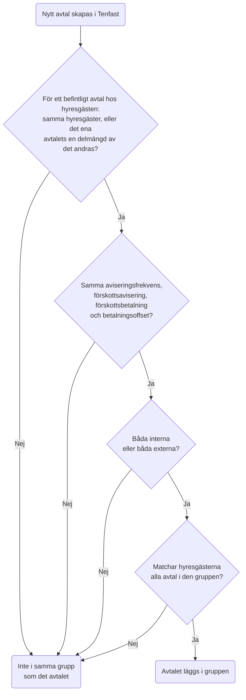

# Samavisering

_Del av [processöversikten](./DOCS_Overview.md) för fakturadistribution._

Samavisering betyder att flera avtal som delar hyresgäster hamnar på en och samma avi, till exempel en bostad och en bilplats. Vilka avtal det gäller står i reglerna nedan. Det är Tenfast som sköter samaviseringen, helt automatiskt. OneCore skickar inget om samavisering när ett avtal skapas, varken från [Xpand-synken](../../scripts/sync-leases/DOCS_Sync_Leases.md), [Direkthyra av bilplats](../parkingspaces/external/DOCS_Create_Lease_for_None_Scored_Parking_Space.md) eller [accepterade erbjudanden](../parkingspaces/internal/DOCS_Accept_Offer.md).

Reglerna nedan kommer från Tenfast (2026-11-17).

## När två avtal samaviseras

Tenfast jämför det nya avtalet med hyresgästens befintliga avtal. Det läggs i samma grupp som ett befintligt avtal när allt det här gäller:

- **Hyresgästerna matchar.** Antingen har avtalen exakt samma hyresgäster, eller så är det ena avtalets hyresgäster en delmängd av det andras. Det räcker inte med en gemensam hyresgäst.
- **Aviseringsinställningarna är lika.** Det gäller hur ofta avin skapas (`aviseringsFrekvens`), hur långt i förväg den skapas (`forskottAvisering`), om hyran betalas i förskott (`betalasForskott`) och förfallodagen i förhållande till perioden (`betalningsOffset`).
- **Båda är interna eller båda externa.** Internt är Tenfasts egen markering på avtalet. Ett internt avtal samaviseras aldrig med ett externt.

Hyresgästerna ska matcha mellan varje par av avtal i gruppen, inte bara mot det nya avtalet. Passar det nya avtalet i flera grupper prioriteras avtal med exakt samma hyresgäster.

### Exempel

Exemplen förutsätter att aviseringsinställningarna är lika och att alla avtal är externa.

| Avtal                                           | Resultat                                                                                                           |
| ----------------------------------------------- | ------------------------------------------------------------------------------------------------------------------ |
| Bostad med A och B, bilplats med A              | Samaviseras. A är en delmängd av A och B. Bostaden blir huvudavtal, om den är signerad.                            |
| Bostad med A, bilplats med A och B              | Samaviseras. Delmängden kan gå åt båda hållen.                                                                     |
| Bostad med A och B, bilplats med A och C        | Ingen samavisering.                                                                                                |
| Bostad med A och B, en bilplats med A, en med B | Alla tre hamnar inte i samma grupp, eftersom bilplatsernas hyresgäster inte är samma eller delmängder av varandra. |

## När grupperingen sker

Avtalet läggs i gruppen när det skapas, inte när det signeras. Det gäller även ett osignerat avtal, till exempel en bilplats som väntar på signering i SimpleSign. Det spelar ingen roll om de befintliga avtalen är signerade.

Signeringen styr i stället vem som kan vara huvudavtal och vad som kommer med på avin:

- Bara ett signerat avtal kan vara huvudavtal. Ett avtal av typen bostad, bostadsrätt eller villa föredras.
- Huvudavtalets avi tar bara med signerade avtal i gruppen.
- När en bilplats signeras läggs dess hyra till via gruppens huvudavtal, så bilplatsen kommer med på nästa avi.

## Att känna till

- **OneCore väljer aldrig grupp.** OneCore skickar inget fält för att välja vilka avtal ett nytt avtal ska samaviseras med, och skickar inte `disableAutoSamAvisering`, som stänger av samavisering för ett avtal. I Tenfasts API-dokumentation (testmiljön, 2026-11-17) finns inget fält för att välja grupp när ett avtal skapas eller ändras.
- **Aviseringsinställningarna måste stämma med de befintliga avtalen.** Både `createLease` och `importLease` i leasing skickar månadsavisering (`1m`), avi två veckor i förväg (`2v`), `betalningsOffset: 1d` och betalning i förskott. Ändras någon av dem i OneCore, eller på de befintliga avtalen i Tenfast, slutar nya avtal att samaviseras med gamla.
- **Det här hände i november 2026.** För att skjuta fram aviseringen till den 16:e ändrade Tenfast hur långt i förväg avin skapas till `12d` (12 dagar) på alla avtal. Avtal som skapades efter Tenfasts import kunde därför inte samaviseras ordentligt. Tenfast har ett ärende för att rätta detta. Den 17 november ändrade Tenfast tillbaka till `2v` på alla avtal, så avtal som skapas därefter ska följa med i samaviseringen automatiskt.
- **`parentAvtal` har inget med samavisering att göra.** Fältet kopplar ett tilläggsavtal till sitt huvudavtal.
- **Huvudavtal vid Tenfasts engångsimport från Xpand.** I Xpand pekade samaviserade avtal ibland på ett upphört huvudavtal. Vid importen sattes huvudavtalet därför till bostadskontraktet, annars till det avtal som började gälla först (AVTAL-265). Det gäller bara importen. Nya avtal grupperas enligt reglerna ovan.
