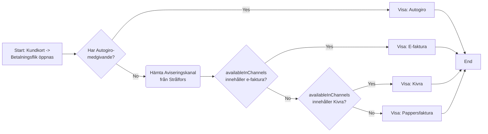
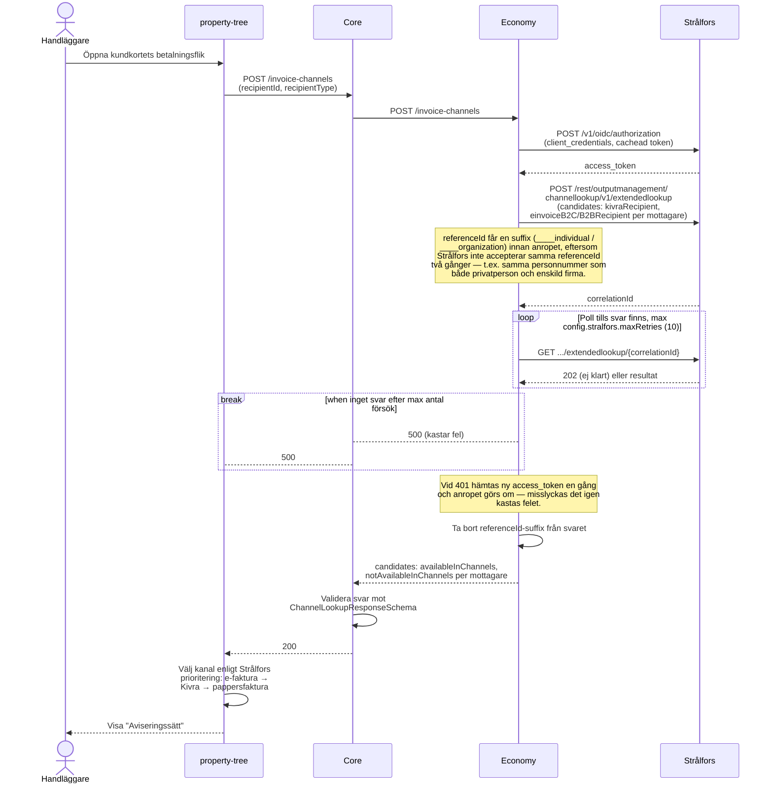

# Hämta Aviseringskanal (Strålfors Channel Lookup)

_Del av [processöversikten](./DOCS_Overview.md) för fakturadistribution._

När en handläggare öppnar en hyresgästs betalningsflik i property-tree hämtas "Aviseringssätt" — en uppgift om hyresgästen kan nås digitalt (Kivra eller e-faktura) eller om det blir pappersfaktura. Uppgiften kommer från Strålfors, som är Mimers leverantör för fakturadistribution och känner till vilka digitala kanaler en mottagare faktiskt är ansluten till. Autogiro kollas separat och går alltid först i UI:t om det finns, oavsett vad kanalslagningen svarar.

Samma endpoint (`/invoice-channels`) anropas även av Tenfast vid fakturagenerering, för att avgöra om en fakturaavgift ska läggas på — se "Att känna till" nedan. Flödet och diagrammen här beskriver anropet från property-tree; anropet från Tenfast går samma väg genom Core/Economy/Strålfors men triggas av fakturagenerering istället för att en handläggare öppnar kundkortet.

## Flödesdiagram

Vilket värde som visas för "Aviseringssätt", i property-tree UI:t. System- och integrationsdetaljer är medvetet utelämnade här — se sekvensdiagrammet nedan för det.

## Sekvensdiagram

Vilka tjänster och externa system som anropas i varje steg, i vilken ordning.

## Att känna till

- Uppslaget svarar bara på vilka kanaler mottagaren **finns** i, inte vilken Strålfors kommer att använda, och `availableInChannels` kommer inte i prioritetsordning (t.ex. `["Kivra", "eInvoiceB2C"]`). `property-tree` tillämpar därför Strålfors egen prioritering, e-faktura (`eInvoiceB2C`/`eInvoiceB2B`) → Kivra → pappersfaktura, så att etiketten visar det aviseringssätt kunden faktiskt får (`features/tenants/lib/invoiceDeliveryMethod.ts`).
- **Felfall i UI:t.** Går det inte att avgöra aviseringssättet visas "Kunde inte hämtas" i stället för ett gissat värde. Det gäller när autogiro-förfrågan misslyckas, när kanalslagningen misslyckas för en kund utan autogiromedgivande, och när Strålfors rapporterar fel (`channelErrors`) för en kanal med högre prioritet än den bästa tillgängliga (t.ex. Kivra tillgänglig men fel på e-faktura). En kund med autogiromedgivande visas som "Autogiro" även om kanalslagningen misslyckas. Att medgivande saknas (404) räknas inte som ett fel.
- Det här är ett rent uppslag — det skickar ingen faktura och påverkar inte vilken kanal Strålfors faktiskt använder när en fil väl skickas (se [Överför Filer till Strålfors](./DOCS_Transfer_Files_to_Stralfors.md)).
- `recipientId` skickas in som personnummer/organisationsnummer från UI:t; Economy strippar bort allt utom siffror innan det skickas vidare till Strålfors.
- **Kanalslagningen styr även om en fakturaavgift läggs på avin.** Tenfast hämtar kanalinformationen via samma `/invoice-channels`-endpoint som property-tree använder (autentiserat med en egen roll, `invoice-channels:read`), och avgör själva utifrån svaret om en fakturaavgift (t.ex. för pappersfaktura) ska läggas på, enligt Mimers inställning för det aktuella aviseringssättet. Onecore gör alltså den faktiska Strålfors-slagningen även i det här fallet — men beräknar, ser eller påverkar inte avgiften själv, bara vilken kanal som väljs.
