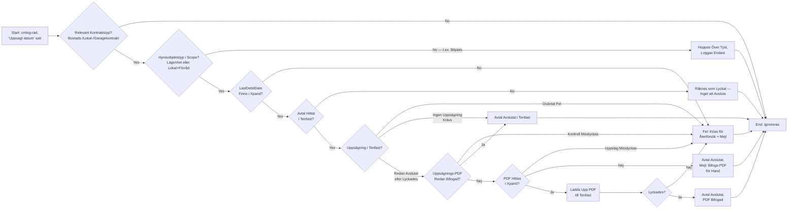
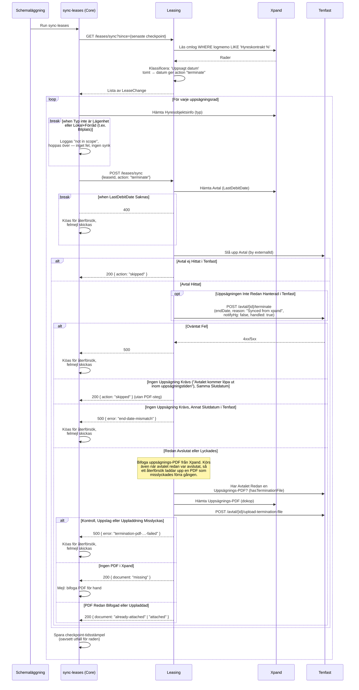

# Synka Uppsägning från Xpand

_Del av [processöversikten](./DOCS_Overview.md) för uppsägning av avtal._

Ett schemalagt script i Core (`core/src/scripts/sync-leases`) pollar Xpands `cmlog`-tabell efter avtal där fältet "Uppsagt datum" precis satts — det vill säga en slutgiltig, bekräftad uppsägning i Xpand (till skillnad från en preliminär uppsägning, som ignoreras helt av den här synken). För varje sådan rad kontrolleras att hyresobjektet är av en typ som ska synkas, varpå avtalet avslutas i Tenfast via Leasing.

## Flödesdiagram

Processens beslutslogik: vilka kontroller som styr om en rad synkas, hoppas över eller köas för återförsök. System- och integrationsdetaljer är medvetet utelämnade här — se sekvensdiagrammet nedan för det.

## Sekvensdiagram

Vilka tjänster som anropas i varje steg, i vilken ordning. Det här är ett fristående, schemalagt script — inte en HTTP-endpoint initierad av en människa.

## Att känna till

- **Bilplatser (Garagekontrakt) synkas aldrig här.** `cmlog`-adaptern klassificerar Garagekontrakt-rader precis som Bostads-/Lokalkontrakt, men filtret `isResidenceOrStorage` i `sync-leases` släpper bara igenom lägenhet eller lokal+förråd. En bilplats som sägs upp direkt i Xpand loggas som "not in scope" och synkas aldrig till Tenfast via det här flödet.
- **Idempotent.** Om avtalet redan är avslutat i Tenfast (Tenfast svarar med felmeddelandet "Avtalet kan inte sägas upp") räknas raden ändå som lyckad — bra för omkörningar, men jämför med [Synka Makulering](./DOCS_Void_Lease_via_Xpand_Sync.md), som saknar motsvarande skydd.
- **Positionen sparas per rad, oavsett utfall — inte bara vid lyckad synk.** `saveSyncPosition` körs utanför try/catch:en, så en misslyckad rad räknas som hanterad precis som en lyckad. Återförsök sker istället via en separat JSONL-kö som dräneras i början av nästa körning, innan nya cmlog-rader hämtas. Varje körning läser om de senaste fem minuterna av cmlog (rader kan bli synliga en stund efter sin logtime) och hoppar över de rader som redan hanterats, så en krasch mitt i en körning gör inte om rader som redan är klara.
- En preliminär xpand-uppsägning (fältet "Preliminärt uppsagt") triggar **inte** det här flödet — bara när "Uppsagt datum" faktiskt sätts.
- **Uppsägnings-PDF:en återförsöks.** Efter en lyckad (eller redan-avslutad) uppsägning bifogar Leasing uppsägningshandlingen från Xpand via `upload-termination-file`. Misslyckas kontrollen, uppslaget i Xpand eller uppladdningen svarar Leasing 500, så raden köas och försöks igen. Vid återförsöket hoppar Leasing över `POST /terminate` när Tenfast redan har en hanterad uppsägning (`cancellation.handledAt` satt) och kör bara PDF-steget. Saknar Xpand PDF:en räknas raden som lyckad och teamet får ett mejl om att bifoga den för hand. Ger kön upp efter 30 dagar säger mejlet att avtalet redan är uppsagt och att bara PDF:en saknas.
- **Ingen uppsägning krävs räknas bara som lyckad när slutdatumen stämmer.** Svarar Tenfast "Avtalet kommer löpa ut inom uppsägningstiden. Ingen uppsägning krävs." jämför Leasing avtalets slutdatum i Tenfast med sista debiteringsdag i Xpand. Är de samma räknas raden som lyckad utan PDF-steg och utan mejl. Skiljer de sig, eller saknar avtalet slutdatum i Tenfast, svarar Leasing 500 `end-date-mismatch`: raden köas och teamet får ett felmejl, eftersom Tenfast annars fortsätter debitera till sitt eget slutdatum. Tenfasts API kan inte flytta slutdatumet på ett signerat avtal, så det rättas för hand i Tenfast. Stämmer datumen vid nästa återförsök räknas raden som lyckad. Ger kön upp efter 30 dagar säger mejlet att slutdatumet ska rättas i Tenfast.
- **En senare makulering ersätter en köad uppsägning.** Ligger uppsägningen kvar i kön när en makulering av samma avtal kommer, tas uppsägningen bort ur kön (mejl: "ersatt av en senare ändring") i stället för att försökas mot ett makulerat avtal. En köad skapanderad ersätts aldrig.
