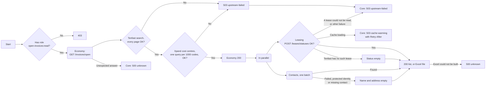
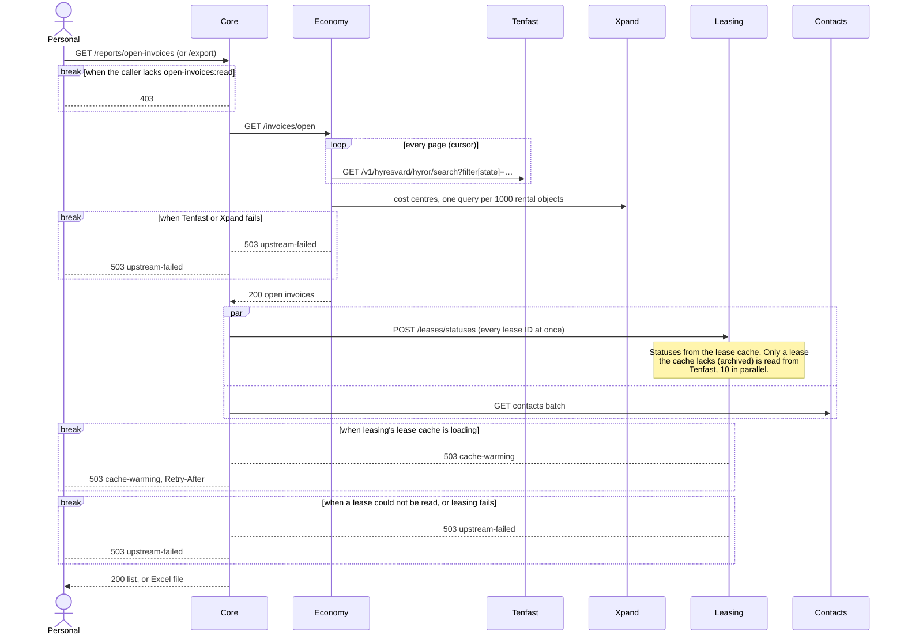

# Restlista (öppna fakturor)

Personal kan lista alla fakturor som inte är betalda, krediterade eller makulerade och som har en skuld kvar, och exportera listan till Excel. Allt går via core. Economy äger fakturorna (Tenfast) och kostnadsställena (Xpand), leasing äger avtalsstatusen och contacts äger namn och adress. Core lägger ihop dem och styr åtkomsten med en roll.

| Route                               | Tjänst  | Roll                 | Vad den gör                                                |
| ----------------------------------- | ------- | -------------------- | ---------------------------------------------------------- |
| `GET /reports/open-invoices`        | core    | `open-invoices:read` | Hela listan, med avtalsstatus, namn och adress             |
| `GET /reports/open-invoices/export` | core    | `open-invoices:read` | Samma lista som Excel, i Bosociala-rapportens 12 kolumner  |
| `GET /invoices/open`                | economy | (intern)             | Öppna fakturor från Tenfast, med kostnadsställe från Xpand |

Rollen ges inte via `api-access` (`core/src/middlewares/route-roles.ts`), eftersom listan visar hyresgästers namn bredvid vad de är skyldiga. Rollen `open-invoices:read` måste finnas i Keycloak i dev, test och prod och tilldelas personal före release.

## Vad som räknas som öppen

- Tenfast-status `ny`, `ej-avprickad`, `forsenad`, `delvis-betald`, `pamind` eller `gracePeriod`. Economy hämtar dem med `GET /v1/hyresvard/hyror/search?filter[state]=…`, alla sidor (cursor), och visar dem utåt som de leverantörsneutrala värdena `new`, `unmatched`, `overdue`, `partially-paid`, `reminded` och `deferred`.
- Skulden (`amount - amountPaid`, avrundad till öre) är större än 0. Fakturor utan skuld filtreras bort i economy.

## Fälten

| Fält                       | Källa                                                                                                                     |
| -------------------------- | ------------------------------------------------------------------------------------------------------------------------- |
| Fakturanummer              | Tenfast `reference`, annars `ocrNumber`                                                                                   |
| Fakturadatum               | Tenfast `activatedAt`, annars `expectedInvoiceDate`, annars `createdAt`, som svensk dag                                   |
| Förfallodatum              | Tenfast `due`, som svensk dag                                                                                             |
| Avtal, hyresobjekt         | Fakturans snapshot (som fakturan skickades), annars de populerade avtalen. Hyresobjekt annars från avtalsnumret           |
| Kundnummer (`contactCode`) | Snapshotens hyresgäster, en person före ett företag, annars avtalets första hyresgäst                                     |
| Kostnadsställe             | Xpand `repsk.p2` för hyresobjektet, en batchad fråga per 1000 hyresobjekt (se nedan)                                      |
| Avtalsstatus               | Leasing, `POST /leases/statuses`, ur leasings avtalscache. Uppsagt och Upphört visas båda som Uppsagt, som i Xpands lista |
| Namn och adress            | Contacts, en batch. Tomma vid contacts-fel, skyddad identitet eller saknad kontakt                                        |
| Dagar sen förfallodatum    | Från förfallodatum till i dag (svensk tid). Negativt före förfallodagen                                                   |

Listan sorteras på förfallodatum, äldst först och fakturor utan förfallodatum sist, sedan på fakturanummer.

Kostnadsstället slås upp på samma sätt som `getPropertyCodeAndCostCentreForLease`: via byggnaden om hyresobjektet har en, annars via ytan, annars via fastigheten, senaste året först. Frågan skickar koderna som `CAST(? AS VARCHAR(30))`, eftersom knex annars skickar NVARCHAR och SQL Server då läser hela tabellen.

## Flödesdiagram

## Sekvensdiagram

## Felhantering

| Fel                                                   | Svar                                                   |
| ----------------------------------------------------- | ------------------------------------------------------ |
| Saknar rollen                                         | 403                                                    |
| Tenfast svarar fel, svaret går inte att tolka, nätfel | 503 `upstream-failed` (economy loggar)                 |
| Xpand-frågan misslyckas                               | 503 `upstream-failed`, aldrig tomma kostnadsställen    |
| Leasings avtalscache laddas för första gången         | 503 `cache-warming` med `Retry-After`                  |
| Leasing kunde inte läsa ett avtal, eller misslyckas   | 503 `upstream-failed`, aldrig en tom avtalsstatus      |
| Tenfast saknar avtalet                                | 200, avtalsstatus tom för den fakturan                 |
| Contacts misslyckas                                   | 200, namn och adress tomma på alla rader (core loggar) |
| Skyddad identitet eller saknad kontakt                | 200, namn och adress tomma på den raden                |
| Oväntat svar från economy                             | 500 `unknown`                                          |
| Excel-filen kan inte byggas                           | 500 `unknown`                                          |

Kundnumret visas även för en skyddad identitet, som i Bosociala-rapporten.

## Kända begränsningar

- **Svaret från `hyror/search` är inte verifierat mot Tenfast test.** Schemat (`TenfastSearchInvoiceSchema` i economy) bygger på economys befintliga fakturascheman och på kollegans Python-verktyg, och är medvetet tolerant: allt utom belopp, förfallodatum och status är valfritt, och hyresgäster, hyresobjekt och avtal får komma som id eller som objekt. Kontrollera mot Tenfast test innan release, och jämför antalet rader med kollegans `/restlista` och onecores restlista från samma dag.
- **Högst 100 sidor från Tenfast.** Economys `fetchAllTenfastPages` slutar efter 100 sidor. Begränsar Tenfast `hyror/search` till 100 poster per sida (som andra sök-endpoints), ger fler än 10 000 öppna fakturor 503 i stället för en ofullständig lista.
- **Avtalsstatus ur leasings avtalscache.** `POST /leases/statuses` slår upp alla avtal i avtalssökningens cache i ett anrop, i stället för ett Tenfast-anrop per avtal (`POST /leases/batch`). Cachen saknar arkiverade avtal, så bara de läses från Tenfast, ett i taget och tio parallellt. Kan något av dem inte läsas svarar leasing 503 för hela anropet, så en tom avtalsstatus betyder alltid att Tenfast saknar avtalet. Statusen kan vara upp till en minut gammal (cachens synk). Listan själv har ingen cache och ingen paginering: economy läser alla öppna fakturor från Tenfast vid varje anrop.
- **Kostnadsställe kommer från Xpand.** Kollegans verktyg tar det från fakturaradernas konteringsrader i Tenfast. Xpand ger samma kostnadsställe som Bosociala-rapporten och onecores tidigare restlista.
