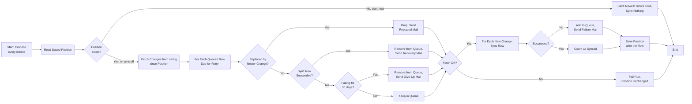

# Synk från Xpand — Processöversikt

Så länge handläggare skapar och ändrar kontakter, hyreskontrakt och hyresobjektstyper i Xpand måste ändringarna föras vidare till de system som numera äger respektive data: **Tenfast** (avtal, hyresgäster och hyresobjekt), **Xledger** (kunder) och **Odoo** (hyresgäster i ärendehanteringen). Det görs av tre fristående script i core-paketet som körs som Kubernetes CronJobs och läser Xpands ändringslogg `cmlog`.

Det här dokumentet beskriver vad som synkas, när, och vad som händer om något ligger nere.

## Processer

| Process                                                                              | Vad den gör                                                                     | Triggas av                                      |
| ------------------------------------------------------------------------------------ | ------------------------------------------------------------------------------- | ----------------------------------------------- |
| [Synka Kontakter](./sync-contacts/DOCS_Sync_Contacts.md)                             | Ändrade kontaktuppgifter i Xpand skrivs vidare till Tenfast, Xledger och Odoo   | CronJob `sync-contacts`, varje minut            |
| [Synka Avtal](./sync-leases/DOCS_Sync_Leases.md)                                     | Tecknade, uppsagda och makulerade hyreskontrakt i Xpand speglas till Tenfast    | CronJob `sync-leases`, varje minut              |
| [Synka Hyresobjektstyp](./sync-rental-object-types/DOCS_Sync_Rental_Object_Types.md) | En ändrad hyresobjektstyp i Xpand sätts som kategori på hyresobjektet i Tenfast | CronJob `sync-rental-object-types`, varje minut |

## Vad synkas

| Ändring i Xpand                                  | `cmlog`-rad som läses                       | Tenfast                                   | Xledger                                                 | Odoo                                         |
| ------------------------------------------------ | ------------------------------------------- | ----------------------------------------- | ------------------------------------------------------- | -------------------------------------------- |
| Kontaktuppgifter (namn, e-post, telefon, adress) | `Kontakt …`                                 | Hyresgästen hämtar nya uppgifter          | Befintlig kund uppdateras (namn, adress, e-post)        | Hyresgäst uppdateras (namn, e-post, telefon) |
| Kontrakt undertecknat                            | `Hyreskontrakt …`, fältet `Undertecknat`    | Avtalet skapas, med hyresgäst och PDF     | Annan fakturamottagare skapas eller uppdateras som kund | –                                            |
| Kontrakt uppsagt                                 | `Hyreskontrakt …`, fältet `Uppsagt datum`   | Avtalet sägs upp, uppsägnings-PDF bifogas | –                                                       | –                                            |
| Kontrakt makulerat                               | `Hyreskontrakt …`, fältet `Makulerat datum` | Avtalet makuleras                         | –                                                       | –                                            |
| Hyresobjektstyp ändrad                           | `Hyresobjekt …`, fältet `Hyresobjekttyp`    | Hyresobjektets kategori sätts             | –                                                       | –                                            |

Avtalssynken tar bara med lägenheter och förråd — se [Synka Avtal](./sync-leases/DOCS_Sync_Leases.md#vilka-objekt-som-är-i-scope). Ingenting synkas åt andra hållet, från Tenfast, Xledger eller Odoo tillbaka till Xpand.

## När

Alla tre CronJobs ligger i `mimer-onecore-operations` (`apps/onecore/core/synccontactscronjob.yaml`, `syncleasescronjob.yaml` och `syncrentalobjecttypescronjob.yaml`) och kör varje minut (`* * * * *`) med `concurrencyPolicy: Forbid`, så en långsam körning aldrig överlappar nästa. `backoffLimit: 0` gör att en misslyckad körning inte startas om — nästa försök är nästa minut. `activeDeadlineSeconds: 300` avbryter en körning som pågått i fem minuter.

Alla tre är `suspend: true` som utgångsläge och slås på per miljö med en Kustomize-patch:

| Miljö                                    | Läge                                                                                       |
| ---------------------------------------- | ------------------------------------------------------------------------------------------ |
| `epic-avtal-49` (dev)                    | Alla tre påslagna                                                                          |
| `epic-uth-345` (dev)                     | Pausade — miljön delar Tenfast-, Strålfors- och Infobip-uppgifter med `epic-avtal-49`      |
| `stage`, `epic-mim-829`, `epic-mim-1838` | `sync-contacts` och `sync-rental-object-types` borttagna; `sync-leases` ligger kvar pausad |
| Produktion                               | Finns inte — `mimer-onecore-operations-production` har inget av de tre jobben (2026-10-22) |

En ändring i Xpand når alltså målsystemen inom ungefär en minut i de miljöer där jobben är påslagna, förutsatt att inget ligger nere.

## Gemensam mekanik

De tre scripten delar kärnan [`shared/run-cmlog-sync.ts`](./shared/run-cmlog-sync.ts) och skiljer sig bara i vilka `cmlog`-rader de läser och vad de gör med varje rad.

### cmlog som ändringskälla

Xpand loggar varje ändring som en rad i tabellen `cmlog`, med ett fritextfält `logmemo` och en tidsstämpel `logtime`. Synken läser nya rader och tolkar texten. Läsningen sker i respektive tjänst: Contacts för kontakter, Leasing för avtal och hyresobjektstyper.

`logtime` är en `datetime` utan tidszon, som Xpand fyller med svensk lokaltid och hela sekunder. Den når Core som svensk lokaltid märkt som UTC, så Core räknar om sin egen klocka till svensk lokaltid på samma sätt innan de jämförs (`onXpandClock` i `run-cmlog-sync.ts`) — poddens tidszon spelar ingen roll. Varje körning läser om ett fönster några minuter bakåt från sparad position och hoppar över de rader den redan hanterat (se [Sparad position](#sparad-position)). Det fångar en rad som syns i `cmlog` först en stund efter sin `logtime`, eftersom Xpand sätter tiden innan raden sparas.

Två luckor finns kvar där rader kan tappas utan fel och utan mejl:

- **När klockan ställs tillbaka** (sista söndagen i oktober) går Xpands klocka 02:00–02:59 två gånger. När positionen nått första varvets 02:59 läses inga rader från andra varvet, eftersom de har en lägre tid än fönstret.
- **En rad som syns mer än fem minuter efter sin `logtime`.** Fönstret täcker fem minuter (`LATE_COMMIT_MS` i `run-cmlog-sync.ts`). Marginalen är inte uppmätt mot Xpand. Samma sak gäller om poddens klocka går mer än fem minuter före Xpands.

### Sparad position

Varje script sparar tidsstämpeln för den senast behandlade raden i en fil på sin egen PersistentVolumeClaim, monterad på `/data`:

| Script                   | Positionsfil                                   | PVC                              |
| ------------------------ | ---------------------------------------------- | -------------------------------- |
| sync-contacts            | `/data/last-timestamp.txt`                     | `sync-contacts-state`            |
| sync-leases              | `/data/last-timestamp-leases.txt`              | `sync-leases-state`              |
| sync-rental-object-types | `/data/last-timestamp-rental-object-types.txt` | `sync-rental-object-types-state` |

Positionen sparas efter varje rad. Bredvid tidsstämpelfilen ligger `<positionsfil>.position.json` med två saker: `readFrom`, varifrån nästa körning läser, och vilka rader i fönstret som redan hanterats (radens nyckel plus en hash av innehållet). `readFrom` flyttas bara framåt, till det senare av senaste ändringen minus fem minuter och körningens start minus tio minuter, så ett jobb utan nya ändringar slutar läsa om efter tio minuter. Båda filerna skrivs till `.tmp` och döps sedan om, så de blir aldrig halvskrivna. Kraschar jobbet mitt i en körning läser nästa körning om fönstret och hoppar över raderna som redan är klara.

Positionen flyttas fram även när en rad misslyckas; det är felkön som håller kvar den. Rader som aldrig läses (luckorna ovan) fångas inte av kön.

**Första körningen**, när både tidsstämpelfilen och `.position.json` saknas, skiljer sig åt:

- `sync-contacts` och `sync-leases` synkar **hela Xpands historik** (`firstRun: 'sync-all'`). För `sync-contacts` går det inte med fler än cirka 2 000 ändrade kontakter — se [Synka Kontakter](./sync-contacts/DOCS_Sync_Contacts.md#att-känna-till).
- `sync-rental-object-types` synkar **ingenting** (`firstRun: 'start-now'`) och börjar från den nyaste raden.

### Felkö och återförsök

En rad som misslyckas läggs i `/data/failed-rows.jsonl` på jobbets PVC, med felmeddelandet. Varje körning läser först nya rader ur `cmlog`, går sedan igenom kön och därefter de nya raderna. Hur ofta en köad rad försöks igen beror på hur länge den har misslyckats:

| Har misslyckats i | Försöks igen                   |
| ----------------- | ------------------------------ |
| Första dygnet     | Varje körning (varje minut)    |
| Dag 2–7           | Var sjätte timme               |
| Dag 8–30          | En gång per dygn               |
| Efter 30 dagar    | Aldrig — raden tas bort ur kön |

**Senare ändringar ersätter köade.** För kontakter och hyresobjektstyper skickas hela kontakten respektive den nya typen varje gång, så en nyare ändring för samma sak — i kön eller bland de nya raderna — stryker den äldre ur kön utan nytt försök. Annars kunde en gammal ändring som till slut lyckas skriva över en nyare. Avtal spelas i stället upp händelse för händelse: en senare händelse **väntar på en köad** för samma avtal. Se [Ordning per avtal](./sync-leases/DOCS_Sync_Leases.md#ordning-per-avtal).

**`.position.json` går före tidsstämpelfilen.** Finns den kvar används den, även om tidsstämpelfilen raderats eller fått ett tidigare datum, och ingenting spelas om. Bara när båda filerna saknas räknas det som första körning. En tom tidsstämpelfil, eller en som inte innehåller ett datum, stoppar jobbet helt: varje körning misslyckas innan något läses eller köas, och inget mejl skickas. Ska synken spelas om från ett visst datum raderas `.position.json` och datumet skrivs i tidsstämpelfilen i ISO-format, t.ex. `2026-10-01T00:00:00.000Z`.

### Steg och återställning

En rad som skriver till flera system gör det i steg, i ordning, via [`processes/sync-steps`](../processes/sync-steps/index.ts): kontakter Xledger → Odoo → Tenfast, avtal Xledger (annan fakturamottagare) → Tenfast. En rad räknas som synkad bara när alla steg lyckats. Misslyckas ett steg körs inga fler, och de steg som redan skrivit återställs i omvänd ordning med värdena de ersatte. Raden köas som vanligt och hela raden körs om vid nästa försök.

- **Två saker återställs inte med flit:** en kund som just skapats i Xledger, och en hyresgäst som Tenfast importerat vid tecknande. Nästa försök återanvänder dem.
- **Tenfast återställs aldrig.** Det är sista steget i båda synkarna, så inget kommer efter som kan misslyckas.
- **Misslyckas en återställning** mejlas teamet en gång per system, och systemet hålls markerat (`undoFailedIn` i kön) tills raden synkas. Ger kön upp nämns systemen i ger upp-mejlet.
- **Felmeddelandet** i kön och i mejlen har formen `<sak> failed to sync: <system>=<fel> (<status>) [<detalj>]`, följt av `outcome unknown`, `already written`, `undone`, `undo failed`, `skipped` och `not attempted` där de gäller. Ett steg som kastar redovisas bara med felets namn, eftersom meddelandet kan innehålla kontaktuppgifter.
- **Kända luckor:** ett steg vars skrivning gick fram men vars svar försvann räknas som misslyckat och återställs inte. En återställning kan skriva över en ändring som någon gjort i sekunderna mellan skrivning och återställning. En rad som fortsätter att misslyckas skriver och återställer vid varje försök.

### Notifieringar via e-post

Allt mejlas till adressen i `EMAIL_ADDRESSES__XPAND_SYNC` (`config.emailAddresses.xpandSync`) via Communication-tjänsten. I dev-klustret är det en Slack-kanals e-postadress (`xpand-synk-…@onecore-group.slack.com`).

| Ämne                                                       | Skickas när                                                                                       |
| ---------------------------------------------------------- | ------------------------------------------------------------------------------------------------- |
| `<script>: nytt fel på …`                                  | En rad misslyckas och läggs i kön                                                                 |
| `<script>: … misslyckas fortfarande`                       | En gång, första gången raden misslyckas efter ett dygn i kön                                      |
| `<script>: ger upp …`                                      | Raden har misslyckats i 30 dagar och tas bort ur kön. Mejlet säger vad som behöver göras för hand |
| `<script>: återställning misslyckades för …`               | En rad synkades bara delvis och kunde inte återställas i ett system. Kräver manuell kontroll      |
| `<script>: tidigare felande … är nu synkat`                | En köad rad lyckas                                                                                |
| `<script>: tidigare felande … synkades inte`               | En köad rad behövde inte synkas till slut (t.ex. hyresobjektet finns inte i Tenfast)              |
| `<script>: tidigare felande … ersatt av en senare ändring` | En köad rad stryks för att en nyare ändring kommit                                                |

Misslyckas samma rad igen med samma innehåll — t.ex. när den läses om efter en krasch — skickas inget nytt mejl. Har en ny rad samma nyckel men annat innehåll än den köade ersätter den den köade raden, och ett nytt mejl skickas. Är adressen inte satt hoppas mejlet över med en varning i loggen. Ett felsvar från Communication loggas inte som ett misslyckat utskick.

Det finns inget mejl för fel som stoppar hela körningen — Xpand eller tjänsten framför den nere, en trasig positionsfil eller ett jobb som hängt sig. De syns bara i loggarna och som misslyckade Kubernetes-Jobs.

## Om något ligger nere

| Vad ligger nere                                                                                                            | Vad händer                                                                                                                                                                                                                                                                                                                                                                                              |
| -------------------------------------------------------------------------------------------------------------------------- | ------------------------------------------------------------------------------------------------------------------------------------------------------------------------------------------------------------------------------------------------------------------------------------------------------------------------------------------------------------------------------------------------------- |
| **Xpand**, eller tjänsten som läser `cmlog` (Contacts, Leasing)                                                            | Positionen står still, så inget tappas — nästa körning som når Xpand läser ifatt. Felet mejlas inte. Kön försöks ändå innan körningen avbryts, så mejl om köade rader kan komma under avbrottet. Når Core inte Contacts avbryts `sync-contacts` innan kön läses.                                                                                                                                        |
| **Ett målsystem** — Tenfast, Xledger, Odoo, eller tjänsten framför det (Leasing, Economy, Work Order, Property Management) | Raden misslyckas, det som redan skrivits i tidigare steg återställs, raden läggs i felkön och ett mejl skickas. Den försöks igen enligt tabellen ovan och synkas så snart målsystemet svarar igen, med ett bekräftelsemejl. Ligger systemet nere i mer än 30 dagar ges raden upp.                                                                                                                       |
| **Ett system som tar emot anropet men aldrig svarar**                                                                      | Anropen har tidsgränser, utom hämtningen av ändrade kontakter i `sync-contacts`. Ett anrop som når sin gräns räknas som ett fel: en rad köas med mejl, en hämtning ur `cmlog` fäller körningen utan mejl. Kubernetes avbryter dessutom varje körning efter fem minuter (`activeDeadlineSeconds: 300`), utan mejl. Nästa minut startar ett nytt jobb från sparad position, och raden som pågick körs om. |
| **E-post** (Communication eller Infobip)                                                                                   | Synken fortsätter. Mejlet skickas inte i efterhand.                                                                                                                                                                                                                                                                                                                                                     |
| **Själva jobbet** — pausat, klustret nere, eller en image som inte startar                                                 | `cmlog` behåller raderna och jobbet läser ifatt från sparad position: kontakter och hyresobjektstyper slås ihop till senaste ändringen, avtal spelas upp händelse för händelse. Med fler än cirka 2 000 ändrade kontakter kommer `sync-contacts` inte ifatt.                                                                                                                                            |
| **Jobbets PVC** försvinner eller töms                                                                                      | Position och felkö är borta, och köade rader glöms utan mejl. Jobbet kör som första gången: kontakter och avtal från början av historiken, hyresobjektstyper från nu. Omspelade avtal som makulerats sedan dess ger fel — se [Synka Avtal](./sync-leases/DOCS_Sync_Leases.md#om-samma-händelse-körs-igen).                                                                                              |

## Gemensamt flödesdiagram

Skelettet som alla tre scripten följer. Vad "Sync Row" gör skiljer sig åt — se respektive dokument.

## Att känna till

- **Bara rader som börjar med rätt text läses.** Ett script ser bara de `cmlog`-rader det letar efter. En ändring som Xpand loggar på ett annat sätt, eller inte loggar alls, synkas aldrig.
- **Relationer synkas inte härifrån** — se [Synka Kontakter](./sync-contacts/DOCS_Sync_Contacts.md#relationer).
- **Avvisar Economy en kund köas raden.** Saknar kontakten t.ex. namn i Xpand svarar Economy med ett 4xx-fel. Raden räknas då som misslyckad och köas med mejl, i både `sync-contacts` och för annan fakturamottagare i `sync-leases`. I `sync-leases` hämtas mottagaren på nytt vid varje försök, så ett återförsök lyckas när uppgiften rättats i Xpand. I `sync-contacts` skickar den köade raden samma uppgifter varje gång och lyckas aldrig; rättelsen skriver en ny `cmlog`-rad som ersätter den.
