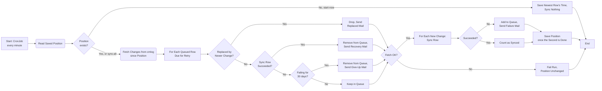

# Synk från Xpand — Processöversikt

Så länge handläggare skapar och ändrar kontakter, hyreskontrakt och hyresobjektstyper i Xpand måste ändringarna föras vidare till de system som numera äger respektive data: **Tenfast** (avtal, hyresgäster och hyresobjekt), **Xledger** (kunder) och **Odoo** (hyresgäster i ärendehanteringen). Det görs av tre fristående script i core-paketet som körs som Kubernetes CronJobs och läser Xpands ändringslogg `cmlog`.

Det här dokumentet beskriver vad som synkas, när, och vad som händer om något ligger nere. Se respektive dokument för detaljer om varje script.

## Processer

| Process                                                                              | Vad den gör                                                                     | Triggas av                                                                   |
| ------------------------------------------------------------------------------------ | ------------------------------------------------------------------------------- | ---------------------------------------------------------------------------- |
| [Synka Kontakter](./sync-contacts/DOCS_Sync_Contacts.md)                             | Ändrade kontaktuppgifter i Xpand skrivs vidare till Tenfast, Xledger och Odoo   | CronJob `sync-contacts` (`mimer-onecore-operations`), varje minut            |
| [Synka Avtal](./sync-leases/DOCS_Sync_Leases.md)                                     | Tecknade, uppsagda och makulerade hyreskontrakt i Xpand speglas till Tenfast    | CronJob `sync-leases` (`mimer-onecore-operations`), varje minut              |
| [Synka Hyresobjektstyp](./sync-rental-object-types/DOCS_Sync_Rental_Object_Types.md) | En ändrad hyresobjektstyp i Xpand sätts som kategori på hyresobjektet i Tenfast | CronJob `sync-rental-object-types` (`mimer-onecore-operations`), varje minut |

## Vad synkas

| Ändring i Xpand                                  | `cmlog`-rad som läses                       | Tenfast                                   | Xledger                                                 | Odoo                                         |
| ------------------------------------------------ | ------------------------------------------- | ----------------------------------------- | ------------------------------------------------------- | -------------------------------------------- |
| Kontaktuppgifter (namn, e-post, telefon, adress) | `Kontakt …`                                 | Hyresgästen hämtar nya uppgifter          | Befintlig kund uppdateras (namn, adress, e-post)        | Hyresgäst uppdateras (namn, e-post, telefon) |
| Kontrakt undertecknat                            | `Hyreskontrakt …`, fältet `Undertecknat`    | Avtalet skapas, med hyresgäst och PDF     | Annan fakturamottagare skapas eller uppdateras som kund | –                                            |
| Kontrakt uppsagt                                 | `Hyreskontrakt …`, fältet `Uppsagt datum`   | Avtalet sägs upp, uppsägnings-PDF bifogas | –                                                       | –                                            |
| Kontrakt makulerat                               | `Hyreskontrakt …`, fältet `Makulerat datum` | Avtalet makuleras                         | –                                                       | –                                            |
| Hyresobjektstyp ändrad                           | `Hyresobjekt …`, fältet `Hyresobjekttyp`    | Hyresobjektets kategori sätts             | –                                                       | –                                            |

Avtalssynken tar bara med lägenheter och förråd — se [Synka Avtal](./sync-leases/DOCS_Sync_Leases.md#vilka-objekt-som-är-i-scope). Ingenting synkas åt andra hållet, från Tenfast, Xledger eller Odoo tillbaka till Xpand.

## När

Alla tre CronJobs ligger i `mimer-onecore-operations` (`apps/onecore/core/synccontactscronjob.yaml`, `syncleasescronjob.yaml` och `syncrentalobjecttypescronjob.yaml`) och kör varje minut (`* * * * *`) med `concurrencyPolicy: Forbid`, så en långsam körning aldrig överlappar nästa. `backoffLimit: 0` gör att en misslyckad körning inte startas om — nästa försök är nästa minut.

Alla tre är `suspend: true` som utgångsläge och slås på per miljö med en Kustomize-patch:

| Miljö                                    | Läge                                                                                       |
| ---------------------------------------- | ------------------------------------------------------------------------------------------ |
| `epic-avtal-49` (dev)                    | Alla tre påslagna                                                                          |
| `epic-uth-345` (dev)                     | Pausade — miljön delar Tenfast-, Strålfors- och Infobip-uppgifter med `epic-avtal-49`      |
| `stage`, `epic-mim-829`, `epic-mim-1838` | `sync-contacts` och `sync-rental-object-types` borttagna; `sync-leases` ligger kvar pausad |
| Produktion                               | Finns inte — `mimer-onecore-operations-production` har inget av de tre jobben (2026-10-22) |

En ändring i Xpand når alltså målsystemen inom ungefär en minut i de miljöer där jobben är påslagna, förutsatt att inget ligger nere.

## Gemensam mekanik

De tre scripten delar samma kärna, [`shared/run-cmlog-sync.ts`](./shared/run-cmlog-sync.ts). Skillnaden ligger i vilka `cmlog`-rader de läser och vad de gör med varje rad.

### cmlog som ändringskälla

Xpand loggar varje ändring som en rad i tabellen `cmlog`, med ett fritextfält `logmemo` och en tidsstämpel `logtime`. Det finns ingen händelsekö och inga webhooks — synken läser nya rader och tolkar texten. Läsningen sker i respektive tjänst: Contacts för kontakter, Leasing för avtal och hyresobjektstyper.

`logtime` är en `datetime` utan tidszon, som Xpand fyller med svensk lokaltid och hela sekunder. Synken läser och jämför den som den är, utan att räkna om tidszon — poddens tidszon spelar ingen roll. Nya rader läses med villkoret `logtime > sparad position`.

Det villkoret har två luckor där rader kan tappas utan fel och utan mejl:

- **När klockan ställs tillbaka** (sista söndagen i oktober) går Xpands klocka 02:00–02:59 två gånger. När positionen nått första varvets 02:59 läses inga rader från andra varvet, eftersom de har en lägre eller samma tid.
- **Inom samma sekund.** Läser synken en rad som loggats 10:00:07, och en annan rad med samma sekund sparas i Xpand strax efter, läses den andra aldrig — nästa körning frågar efter rader efter 10:00:07.

### Sparad position

Varje script sparar tidsstämpeln för den senast behandlade raden i en fil på sin egen PersistentVolumeClaim, monterad på `/data`:

| Script                   | Positionsfil                                   | PVC                              |
| ------------------------ | ---------------------------------------------- | -------------------------------- |
| sync-contacts            | `/data/last-timestamp.txt`                     | `sync-contacts-state`            |
| sync-leases              | `/data/last-timestamp-leases.txt`              | `sync-leases-state`              |
| sync-rental-object-types | `/data/last-timestamp-rental-object-types.txt` | `sync-rental-object-types-state` |

Positionen skrivs under körningens gång, inte i slutet — men först när alla rader inom samma sekund är behandlade. Kraschar jobbet mitt i en sekund läser nästa körning om hela den sekunden, i stället för att hoppa över resten av den. Filen skrivs till `.tmp` och döps sedan om, så den blir aldrig halvskriven.

Positionen flyttas fram även när en rad misslyckas. Det är felkön nedan, inte positionen, som ser till att en rad som läst men misslyckats inte tappas bort. Rader som aldrig läses — se luckorna ovan — fångas inte av kön.

**Första körningen**, när positionsfilen saknas, skiljer sig åt:

- `sync-contacts` och `sync-leases` synkar **hela Xpands historik** (`firstRun: 'sync-all'`) — avsiktligt men tungt. För `sync-contacts` går det inte alls om fler än cirka 2 000 kontakter har ändrats: Contacts frågar efter alla i en enda SQL-fråga, och SQL Server tillåter högst 2 100 parametrar. Körningen misslyckas varje minut utan att flytta positionen — se [Synka Kontakter](./sync-contacts/DOCS_Sync_Contacts.md#att-känna-till).
- `sync-rental-object-types` synkar **ingenting** (`firstRun: 'start-now'`). Den sparar bara tidpunkten för den nyaste raden och börjar därifrån nästa minut.

### Felkö och återförsök

En rad som misslyckas läggs i `/data/failed-rows.jsonl` på jobbets PVC, med felmeddelandet. Varje körning läser först nya rader ur `cmlog`, går sedan igenom kön och därefter de nya raderna. Hur ofta en köad rad försöks igen beror på hur länge den har misslyckats:

| Har misslyckats i | Försöks igen                   |
| ----------------- | ------------------------------ |
| Första dygnet     | Varje körning (varje minut)    |
| Dag 2–7           | Var sjätte timme               |
| Dag 8–30          | En gång per dygn               |
| Efter 30 dagar    | Aldrig — raden tas bort ur kön |

**Senare ändringar ersätter köade.** För kontakter och hyresobjektstyper är bara den senaste ändringen intressant, eftersom hela kontakten respektive den nya typen skickas varje gång. Finns en nyare ändring för samma kontakt eller hyresobjekt — i kön eller bland de nya raderna — stryks den äldre ur kön utan nytt försök. Annars skulle en gammal ändring som till slut lyckas kunna skriva över en nyare. För avtal gäller inte det här: varje händelse spelas upp för sig, och en senare händelse väntar inte på en tidigare som ligger i kön — se [Synka Avtal](./sync-leases/DOCS_Sync_Leases.md#vilka-händelser-som-plockas-upp).

**Positionsfilen ska raderas, inte tömmas.** Bara en saknad fil räknas som första körning. En tom fil, eller en fil som inte innehåller ett datum, stoppar jobbet helt: varje körning misslyckas innan något läses eller köas, och inget mejl skickas. Ska synken spelas om från ett visst datum skrivs det i ISO-format, t.ex. `2026-10-01T00:00:00.000Z`.

### Notifieringar via e-post

Allt mejlas till adressen i `EMAIL_ADDRESSES__XPAND_SYNC` (`config.emailAddresses.xpandSync`) via Communication-tjänsten. I dev-klustret är det en Slack-kanals e-postadress (`xpand-synk-…@onecore-group.slack.com`).

| Ämne                                                       | Skickas när                                                                                       |
| ---------------------------------------------------------- | ------------------------------------------------------------------------------------------------- |
| `<script>: nytt fel på …`                                  | En rad misslyckas och läggs i kön                                                                 |
| `<script>: … misslyckas fortfarande`                       | En gång, första gången raden misslyckas efter ett dygn i kön                                      |
| `<script>: ger upp …`                                      | Raden har misslyckats i 30 dagar och tas bort ur kön. Mejlet säger vad som behöver göras för hand |
| `<script>: tidigare felande … är nu synkat`                | En köad rad lyckas                                                                                |
| `<script>: tidigare felande … synkades inte`               | En köad rad behövde inte synkas till slut (t.ex. hyresobjektet finns inte i Tenfast)              |
| `<script>: tidigare felande … ersatt av en senare ändring` | En köad rad stryks för att en nyare ändring kommit                                                |

Misslyckas samma rad igen utan att ha ändrats — t.ex. efter en krasch mitt i en sekund — skickas inget nytt mejl. Är adressen inte satt loggas en varning och mejlet hoppas över. Svarar Communication med fel loggas det inte som ett misslyckat utskick.

Det finns inget mejl för fel som stoppar hela körningen — Xpand eller tjänsten framför den nere, en trasig positionsfil eller ett jobb som hängt sig. De syns bara i loggarna och som misslyckade Kubernetes-Jobs.

## Om något ligger nere

| Vad ligger nere                                                                                                            | Vad händer                                                                                                                                                                                                                                                                                                                                                                                                                                                               |
| -------------------------------------------------------------------------------------------------------------------------- | ------------------------------------------------------------------------------------------------------------------------------------------------------------------------------------------------------------------------------------------------------------------------------------------------------------------------------------------------------------------------------------------------------------------------------------------------------------------------ |
| **Xpand**, eller tjänsten som läser `cmlog` (Contacts, Leasing)                                                            | Inga nya rader kan läsas och positionen står still, så nya rader tappas inte — nästa körning som når Xpand läser ifatt. Felet i sig mejlas inte. Köade rader försöks ändå igen innan körningen avbryts, så mejl om köade rader kan komma under avbrottet: avtalsrader behöver Xpand och misslyckas igen ("misslyckas fortfarande", "ger upp"), medan hyresobjektstyper kan lyckas ("är nu synkat"). Når Core inte Contacts alls avbryts `sync-contacts` innan kön läses. |
| **Ett målsystem** — Tenfast, Xledger, Odoo, eller tjänsten framför det (Leasing, Economy, Work Order, Property Management) | Raden misslyckas, läggs i felkön och ett mejl skickas. Den försöks igen enligt tabellen ovan och synkas så snart målsystemet svarar igen, med ett bekräftelsemejl. Ligger systemet nere i mer än 30 dagar ges raden upp. Undantag: svarar Economy med ett 4xx-fel räknas det som lyckat — se [Att känna till](#att-känna-till).                                                                                                                                          |
| **Ett system som tar emot anropet men aldrig svarar**                                                                      | De flesta anrop i `sync-leases` och `sync-rental-object-types`, och mejlutskicket i alla tre, saknar tidsgräns. Jobbet hänger då kvar, och eftersom ett nytt jobb inte startar medan det gamla kör (`concurrencyPolicy: Forbid`, ingen `activeDeadlineSeconds`) stannar synken helt — utan fel och utan mejl — tills någon tar bort podden.                                                                                                                              |
| **E-post** (Communication eller Infobip)                                                                                   | Synken fortsätter. Mejlet skickas inte i efterhand.                                                                                                                                                                                                                                                                                                                                                                                                                      |
| **Själva jobbet** — pausat, klustret nere, eller en image som inte startar                                                 | `cmlog` behåller raderna. När jobbet kör igen läser det ifatt från sparad position. Efter ett långt avbrott kommer allt på en gång: kontakter och hyresobjektstyper slås ihop till senaste ändringen, avtal spelas upp händelse för händelse. Har fler än cirka 2 000 kontakter ändrats kommer `sync-contacts` inte ifatt alls.                                                                                                                                          |
| **Jobbets PVC** försvinner eller töms                                                                                      | Positionen och felkön är borta. Köade rader glöms utan mejl. Jobbet beter sig som vid första körningen: kontakter och avtal synkas om från början av Xpands historik, hyresobjektstyper börjar från nu och missar ändringar som gjordes under avbrottet. Att spela upp avtalshistoriken igen ger fel för avtal som makulerats sedan dess — se [Synka Avtal](./sync-leases/DOCS_Sync_Leases.md#om-samma-händelse-körs-igen).                                              |

## Gemensamt flödesdiagram

Skelettet som alla tre scripten följer. Vad "Sync Row" gör skiljer sig åt — se respektive dokument.

## Att känna till

- **Bara rader som börjar med rätt text läses.** Ett script ser bara de `cmlog`-rader det letar efter. En ändring som Xpand loggar på ett annat sätt, eller inte loggar alls, synkas aldrig.
- **Relationer synkas inte härifrån.** God man, förvaltare och annan fakturamottagare som ändras i Xpand når inte Tenfast eller Xledger via någon av de här synkarna. Relationer läses från Contacts-tjänstens egen databas, och ändringar som görs på kundkortet i ONECore förs vidare direkt av Core (`core/src/processes/contacts/relation-changes.ts`). Se [Synka Kontakter](./sync-contacts/DOCS_Sync_Contacts.md#relationer).
- **Ett 4xx-svar från Economy räknas som lyckat.** Core tar emot alla svar under 500 som giltiga i hela processen, och anropet till Economy kontrollerar inte statuskoden. Avvisar Economy en kund (t.ex. en kontakt utan namn) uppdateras inte Xledger, men raden räknas som synkad — ingen kö, inget mejl. Det gäller både `sync-contacts` och annan fakturamottagare i `sync-leases`.
- **Varje jobb har egen kö.** Filen heter `failed-rows.jsonl` för alla tre, men ligger på varsin PVC. Raderna i kön är dessutom märkta med typ (`contact`, `lease`, `rental-object-type`) och ett script rör bara sina egna.
