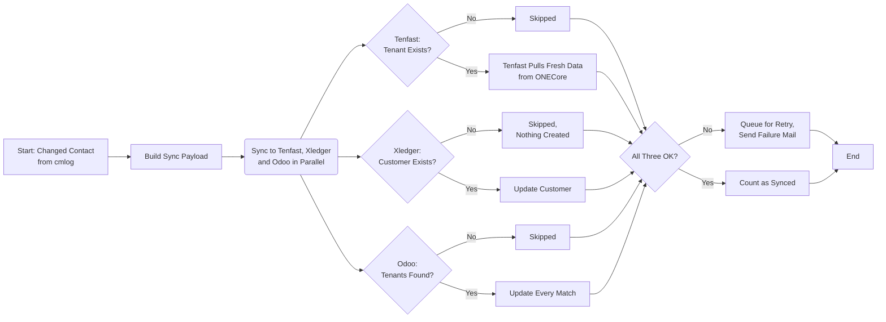
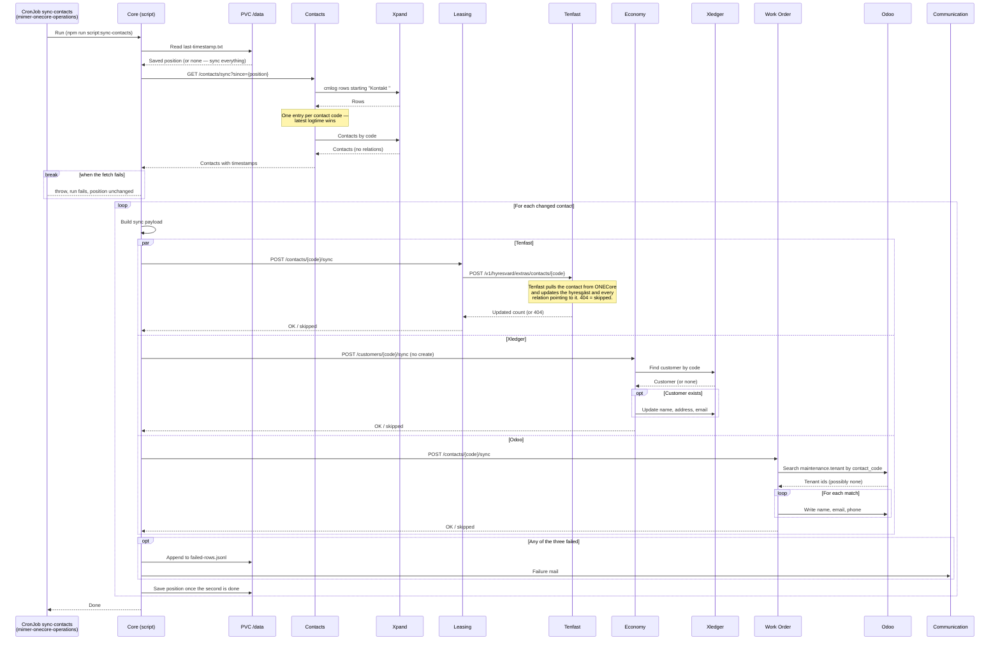

# Synka Kontakter från Xpand

_Del av [processöversikten](../DOCS_Sync_Overview.md) för Xpand-synk. Där beskrivs det gemensamma — sparad position, felkö, återförsök, notifieringar, schemaläggning och vad som händer om något ligger nere — som inte upprepas här._

Ett fristående script (`core/src/scripts/sync-contacts/index.ts`) hämtar de kontakter som ändrats i Xpand sedan förra körningen och skriver dem vidare till de tre system som håller egna kopior av kontaktuppgifter: **Tenfast** (hyresgäster), **Xledger** (kunder) och **Odoo** (hyresgäster i ärendehanteringen). Xpand är källan; de tre målen uppdateras, aldrig tvärtom.

Scriptet körs som CronJobbet `sync-contacts` varje minut. Vid första körningen, utan sparad position, synkas samtliga kontakter som någonsin loggats i Xpand.

## Vilka ändringar som plockas upp

Contacts-tjänsten (`GET /contacts/sync`) läser `cmlog`-rader som börjar med `Kontakt ` och plockar ut kontaktkoden ur första ordet efter. Har samma kontakt ändrats flera gånger sedan förra körningen blir det en enda synk, med den senaste tidsstämpeln — hela kontakten hämtas färskt ändå. Kontaktuppgifterna läses därefter ur Xpand. En kontaktkod som inte längre finns i Xpand faller bort tyst.

## Vad som synkas

Core plattar ut kontakten till en synkpayload (`payload.ts`) och skickar olika delar till olika mål:

| Fält                        | Tenfast | Xledger | Odoo |
| --------------------------- | :-----: | :-----: | :--: |
| Namn                        |    –    |    ✓    |  ✓   |
| E-post                      |    –    |    ✓    |  ✓   |
| Telefon                     |    –    |    –    |  ✓   |
| Gatuadress, postnummer, ort |    –    |    ✓    |  –   |

- **Namn** är personens fullständiga namn för privatpersoner och organisationens namn för företag.
- **E-post och telefon** är den post som är markerad som primär, annars den första i listan.
- **Adress** är kontaktens första adress.

Tenfast-kolumnen är tom med flit: dit skickas **bara kontaktkoden**. Tenfast hämtar själv färska kontaktuppgifter från ONECore och uppdaterar hyresgästen, och alla relationer som pekar på samma kontakt.

## Vad varje målsystem gör

Ingen av de tre skapar något nytt i det här flödet — de uppdaterar bara det som redan finns.

- **Tenfast** — en kontakt som inte finns som hyresgäst ger 404, vilket räknas som lyckat (hoppas över).
- **Xledger** — kunden slås upp på kontaktkod. Finns den uppdateras namn, gatuadress, postnummer, ort och e-post. Saknas den händer ingenting: scriptet skapar medvetet inga kunder. En helt ny kontakt når Xledger först när den behövs, som annan fakturamottagare på ett nytt avtal i [sync-leases](../sync-leases/DOCS_Sync_Leases.md#annan-fakturamottagare) eller när en relation läggs till på kundkortet. En tom adress eller e-post i Xpand skrivs som tom i Xledger.
- **Odoo** — `maintenance.tenant` söks upp på `contact_code`. Hittas ingen räknas raden som lyckad. Hittas flera uppdateras alla. Namnet skrivs alltid; e-post och telefon bara om kontakten har en sådan.

## Relationer

**Scriptet läser och skickar inga relationer** — god man, förvaltare och annan fakturamottagare. Synk-endpointen tar inte med dem, och synkpayloaden har inga fält för dem.

En god man eller fakturamottagare synkas ändå som sig själv: hen är en egen kontakt med egen kontaktkod, och när hens uppgifter ändras i Xpand skrivs en egen `Kontakt`-rad i `cmlog`. Det som _inte_ händer är någon spridning: scriptet tittar inte på vems god man hen är. För Tenfast behövs det inte, eftersom Tenfast själv uppdaterar alla relationer som pekar på samma kontakt. Xledger och Odoo har ingen relationsmodell att uppdatera.

Relationerna själva hanteras utanför den här synken:

- **Relationer läses från Contacts-tjänstens egen databas**, inte från Xpand. En relation som ändras i Xpand når därför inte Tenfast via ONECore.
- **Relationer som ändras på kundkortet i ONECore** förs vidare direkt av Core när handläggaren sparar (`core/src/processes/contacts/relation-changes.ts`): en ny annan fakturamottagare skapas som kund i Xledger, och huvudmannens hyresgäst i Tenfast synkas om. Det sker inom samma anrop, utan kö — misslyckas Tenfast rullas ändringen tillbaka.

## Felhantering

De tre anropen görs parallellt och **alla tre måste lyckas** för att raden ska räknas som synkad. Misslyckas något hamnar hela raden i felkön, med status per mål i felmeddelandet (`tenfast=… xledger=… odoo=…`).

Ett återförsök kör om alla tre, även de som redan lyckats. Det är ofarligt eftersom alla tre bara uppdaterar befintlig data.

Kommer en nyare ändring för samma kontakt medan en äldre ligger i kön stryks den äldre — se [processöversikten](../DOCS_Sync_Overview.md#felkö-och-återförsök). Ger synken upp efter 30 dagar är rådet i mejlet att göra ändringen i Xpand på nytt.

## Flödesdiagram

Processens beslutslogik för en kontakt. System- och integrationsdetaljer är medvetet utelämnade här — se sekvensdiagrammet nedan för det. Kö och sparad position finns i [processöversiktens flödesdiagram](../DOCS_Sync_Overview.md#gemensamt-flödesdiagram).

## Sekvensdiagram

Vilka tjänster som anropas i varje steg, i vilken ordning. Det här är ett fristående, schemalagt script — inte en HTTP-endpoint initierad av en människa. Kön gås igenom med samma anropskedja och är utelämnad här.

## Att känna till

- **Bara befintliga poster uppdateras.** En kontakt som är ny i Xpand dyker inte upp i Tenfast, Xledger eller Odoo genom den här synken. Den kommer in den väg där den först behövs — t.ex. när ett avtal skapas.
- **Telefon går bara till Odoo**, och adressen bara till Xledger.
- **Första körningen är tung.** Utan sparad position hämtas alla kontakter som någonsin loggats, och anropet mot Contacts har ingen tidsgräns just därför.
