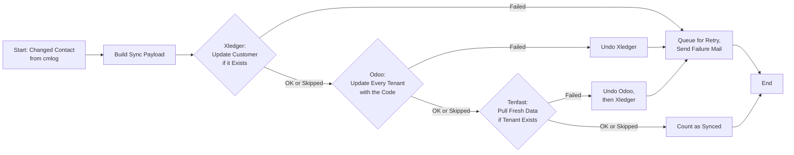
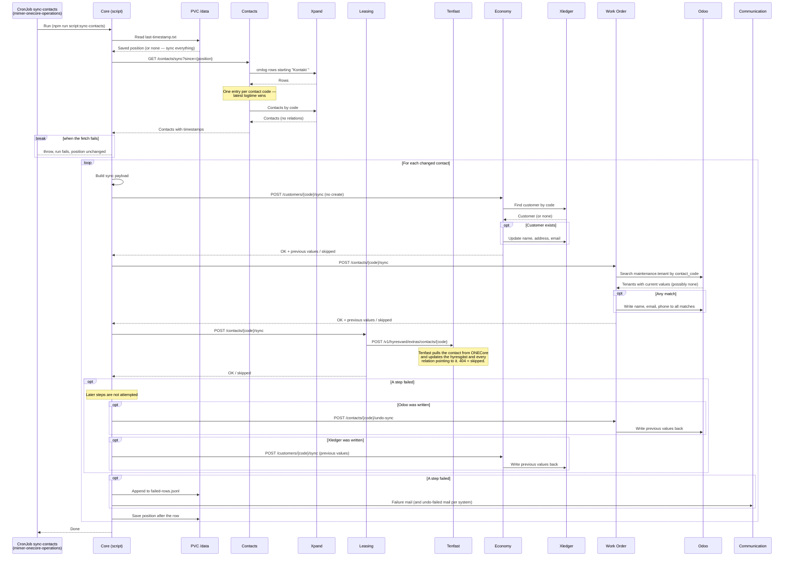

# Synka Kontakter från Xpand

_Del av [processöversikten](../DOCS_Sync_Overview.md), som beskriver det gemensamma: schema, sparad position, felkö, mejl och avbrott._

Ett fristående script (`core/src/scripts/sync-contacts/index.ts`) hämtar de kontakter som ändrats i Xpand sedan förra körningen och skriver dem vidare till de tre system som håller egna kopior av kontaktuppgifter: **Tenfast** (hyresgäster), **Xledger** (kunder) och **Odoo** (hyresgäster i ärendehanteringen).

## Vilka ändringar som plockas upp

Contacts-tjänsten (`GET /contacts/sync`) läser `cmlog`-rader som börjar med `Kontakt ` och plockar ut kontaktkoden ur första ordet efter. Flera ändringar av samma kontakt blir en synk, med den senaste tidsstämpeln. Kontaktuppgifterna läses därefter ur Xpand, i en enda fråga för alla ändrade koder. En kontaktkod som inte längre finns i Xpand faller bort tyst. Det kan även en befintlig kontakt göra: frågan begränsas till lika många kontaktrader som koder, så om en kod har två rader i Xpands kontakttabell trängs en annan ändrad kontakt ut — utan logg och utan mejl. Om sådana dubbletter finns i Xpand i dag är inte kontrollerat.

## Vad som synkas

Core plattar ut kontakten till en synkpayload (`payload.ts`) och skickar olika delar till olika mål:

| Fält                        | Tenfast | Xledger | Odoo |
| --------------------------- | :-----: | :-----: | :--: |
| Namn                        |    –    |    ✓    |  ✓   |
| E-post                      |    –    |    ✓    |  ✓   |
| Telefon                     |    –    |    –    |  ✓   |
| Gatuadress, postnummer, ort |    –    |    ✓    |  –   |

- **Namn** är personens fullständiga namn för privatpersoner och organisationens namn för företag.
- **E-post och telefon** är den post som är markerad som primär, annars den första i listan.
- **Adress** är kontaktens första adress.

Två undantag ändrar vad som skickas:

- **Skyddad identitet.** För en kontakt med skyddade personuppgifter (lagsökt) visar Contacts de riktiga uppgifterna om kontakten är hyresgäst på ett avtal som gäller, ska börja gälla eller slutade för högst 60 dagar sedan, eller är annan fakturamottagare på en aktiv relation. Uppgifterna i Xpand är redan fingerade för dem, och synken skickar dem vidare som för alla andra. Övriga kontakter med skyddad identitet får namnet `redacted` och ingen adress, e-post eller telefon, i alla miljöer. Synken skriver det vidare: kunden i Xledger får namnet `redacted` och tom adress och e-post, och hyresgästen i Odoo får namnet `redacted` (e-post och telefon lämnas som de var). Det rör i praktiken bara tidigare hyresgäster som flyttade för mer än 60 dagar sedan, och har bedömts inte vara värt att åtgärda ([AVTAL-361](https://linear.app/mimer-onecore/issue/AVTAL-361)).
- **Testmiljöer.** Utanför produktion (`NODE_ENV` är inte `production`) ersätter Contacts all e-post och alla telefonnummer med `redacted`. I `epic-avtal-49`, där jobbet körs, skriver synken därför `redacted` som e-post i Xledger och Odoo och som telefon i Odoo. Det är inget fel i synken.

Tenfast-kolumnen är tom med flit: dit skickas **bara kontaktkoden**. Tenfast hämtar själv färska kontaktuppgifter från ONECore och uppdaterar hyresgästen, och alla relationer som pekar på samma kontakt.

## Vad varje målsystem gör

Ingen av de tre skapar något nytt i det här flödet — de uppdaterar bara det som redan finns.

- **Tenfast** — en kontakt som inte finns som hyresgäst ger 404, vilket räknas som lyckat (hoppas över). Tenfast sparar det den hämtar och hämtar inte igen förrän något triggar det. En hyresgäst som sparats med gamla eller dolda (`redacted`) uppgifter kan hämtas om för hand med `POST /v1/contacts/sync-to-leasing` i Core med en lista av kontaktkoder (`{ "contactCodes": [...] }`, högst 50 per anrop, kräver rollen `contacts:write`). Den gör samma anrop som det här steget för varje kod och svarar med utfallet per kod (`synced`, `skipped`, `sync-failed`, `leasing-unreachable` eller `not-attempted`). Svarar leasing inte alls på tre anrop i rad avbryts körningen och resten av koderna får `not-attempted` — skicka dem igen när leasing är uppe.
- **Xledger** — kunden slås upp på kontaktkod. Finns den uppdateras namn, gatuadress, postnummer, ort och e-post. Saknas den händer ingenting: scriptet skapar medvetet inga kunder. En helt ny kontakt når Xledger först när den behövs, som annan fakturamottagare på ett nytt avtal i [sync-leases](../sync-leases/DOCS_Sync_Leases.md#annan-fakturamottagare) eller när en relation läggs till på kundkortet. En tom adress eller e-post skrivs som tom i Xledger — även när den bara saknas för att Contacts döljer en skyddad identitet (se ovan). Uppdateringen görs varje gång, även om inget har ändrats.
- **Odoo** — `maintenance.tenant` söks upp på `contact_code`. Hittas ingen räknas raden som lyckad. Hittas flera uppdateras alla i ett anrop. Namnet skrivs alltid; e-post och telefon bara om kontakten har en sådan.

## Relationer

**Scriptet läser och skickar inga relationer** — god man, förvaltare och annan fakturamottagare. Synk-endpointen tar inte med dem, och synkpayloaden har inga fält för dem.

En god man eller fakturamottagare är en egen kontakt och synkas som sig själv när hens uppgifter ändras. Scriptet sprider inget vidare till huvudmannen; Tenfast uppdaterar själv relationer som pekar på kontakten, och Xledger och Odoo har ingen relationsmodell.

Relationerna själva hanteras utanför den här synken:

- **Relationer läses från Contacts-tjänstens egen databas**, inte från Xpand. En relation som ändras i Xpand når därför inte Tenfast via ONECore.
- **Relationer som ändras på kundkortet i ONECore** förs vidare direkt av Core när handläggaren sparar (`core/src/processes/contacts/relation-changes.ts`): en ny annan fakturamottagare skapas som kund i Xledger, och huvudmannens hyresgäst i Tenfast synkas om. Det sker inom samma anrop, utan kö — misslyckas Tenfast rullas ändringen tillbaka.

## Felhantering

Målen skrivs i ordning, Xledger → Odoo → Tenfast, och **alla tre måste lyckas** för att raden ska räknas som synkad. Misslyckas ett steg körs inte de följande, och Xledger och Odoo får tillbaka sina gamla värden — se [Steg och återställning](../DOCS_Sync_Overview.md#steg-och-återställning). Odoo återställer varje hyresgäst till sina egna gamla värden, tömmer fält som var tomma, och hoppar över hyresgäster som tagits bort sedan.

Avvisar Economy kunden (4xx) lyckas den köade raden aldrig, eftersom den skickar samma uppgifter igen; rättelsen i Xpand ger en ny `cmlog`-rad som ersätter den.

Ett återförsök kör om alla tre från början. Ger synken upp efter 30 dagar är rådet i mejlet att göra ändringen i Xpand på nytt.

## Flödesdiagram

Processens beslutslogik för en kontakt. Kö och sparad position finns i [processöversiktens flödesdiagram](../DOCS_Sync_Overview.md#gemensamt-flödesdiagram).

## Sekvensdiagram

Vilka tjänster som anropas, i vilken ordning. Kön går igenom samma kedja och är utelämnad.

## Att känna till

- **Högst cirka 2 000 ändrade kontakter per körning.** Contacts hämtar alla ändrade kontakter i en enda SQL-fråga med en parameter per kontaktkod, och SQL Server tillåter högst 2 100 parametrar. Har fler ändrats svarar Contacts med fel och positionen står still, så synken kommer aldrig ifatt, utan mejl. Det gäller första körningen och varje tillräckligt långt avbrott.
