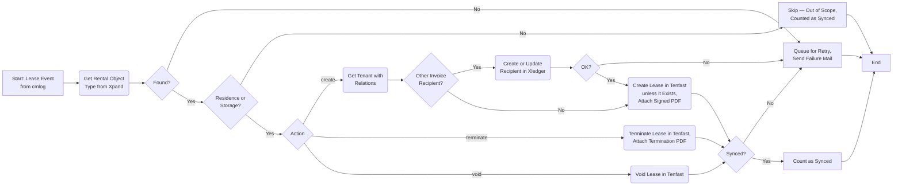
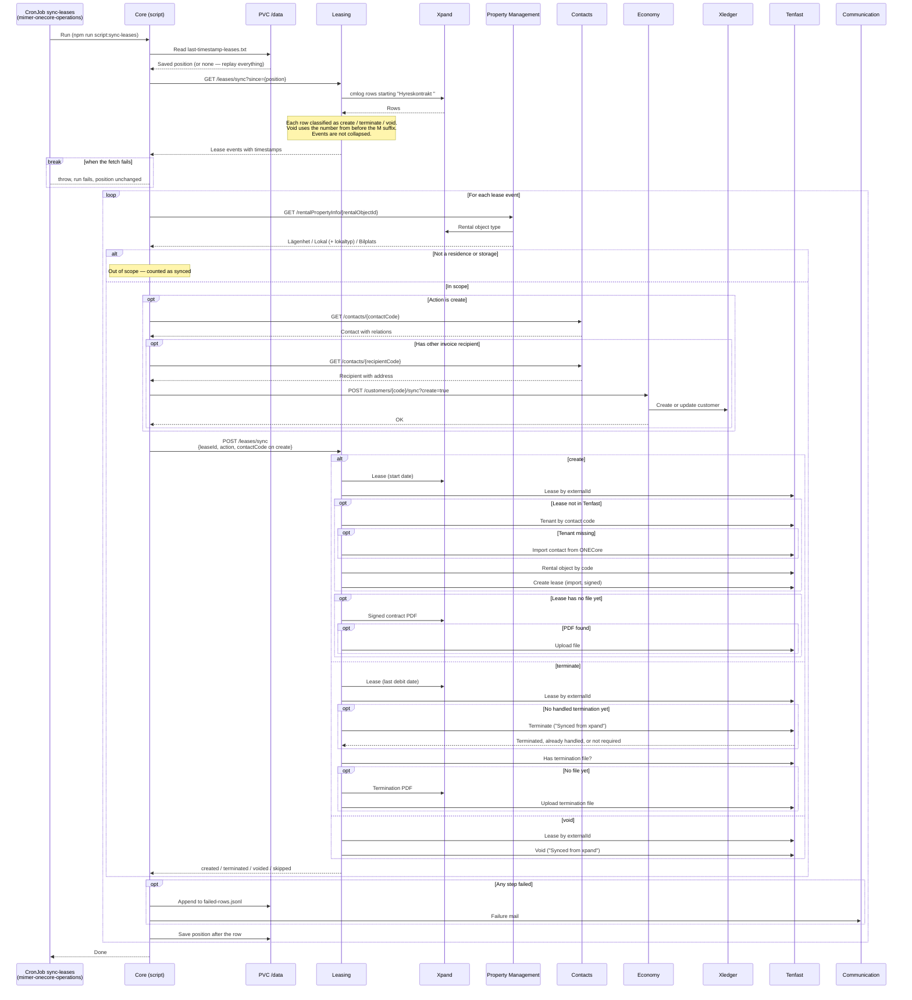

# Synka Avtal från Xpand

_Del av [processöversikten](../DOCS_Sync_Overview.md), som beskriver det gemensamma: schema, sparad position, felkö, mejl och avbrott._

Ett fristående script (`core/src/scripts/sync-leases/index.ts`) speglar hyreskontrakt från Xpand till **Tenfast**.

Till skillnad från [kontaktsynken](../sync-contacts/DOCS_Sync_Contacts.md), som bara uppdaterar befintlig data, **skapar** den här synken avtal i Tenfast — med hyresgäst, hyresrader och kontrakts-PDF — och avslutar dem.

## Vilka händelser som plockas upp

Leasing-tjänsten (`GET /leases/sync`) läser `cmlog`-rader som börjar med `Hyreskontrakt ` och klassificerar varje rad utifrån vilket fält som gått från tomt till ett datum:

| Fält som satts i Xpand | Action      | Vad som händer i Tenfast                          |
| ---------------------- | ----------- | ------------------------------------------------- |
| `Undertecknat`         | `create`    | Avtalet skapas, med hyresgäst, hyresrader och PDF |
| `Uppsagt datum`        | `terminate` | Avtalet sägs upp och uppsägnings-PDF:en bifogas   |
| `Makulerat datum`      | `void`      | Avtalet makuleras                                 |

- Bara `Bostadskontrakt`, `Lokalkontrakt` och `Garagekontrakt` tas med. Andra rader, och rader som saknar kontraktsnummer, kontaktkod eller något av fälten ovan, hoppas över utan loggning.
- Kontraktsnummer och kontaktkod läses ur radens första rad. Hyresobjektets kod är kontraktsnumret utan sista `/`-delen.
- Ett preliminärt uppsagt kontrakt triggar ingenting — bara när `Uppsagt datum` sätts.

**Makulerade avtal byter nummer i Xpand** (`…/10` → `…/10M`), medan Tenfast känner avtalet under det gamla. Det gamla numret läses ur raden `Värdet i fältet 'Kontraktsnummer' ändrat från … till …` i samma logg-post; saknas den loggas makuleringen som varning och hoppas över.

**Händelser slås inte ihop.** Varje händelse spelas upp i ordning, så ett avtal som både tecknats och sagts upp sedan förra körningen hamnar rätt i Tenfast — se [Ordning per avtal](#ordning-per-avtal).

## Vilka objekt som är i scope

Innan något skickas till Tenfast hämtar Core hyresobjektets typ från Xpand via Property Management, för alla tre actions:

- **Lägenhet** — synkas.
- **Lokal** vars lokaltyp är **Förråd** — synkas.
- Allt annat, bland annat **Bilplats** och övriga lokaler — hoppas över. Raden loggas (`rental object type not in scope, skipping`) och räknas som lyckad.

Garagekontrakt plockas alltså upp ur loggen men faller bort här. Bilplatser hanteras direkt i Tenfast — se [Uppsägning av Avtal](../../processes/leasetermination/DOCS_Overview.md).

Går objektinformationen inte att hämta räknas raden som ett **fel** och hamnar i felkön — till skillnad från "utanför scope". Det gäller även Xpands fjärde sort, Övrigt (`bahyr`), som Property Management svarar på med serverfel: raden köas och ges upp efter 30 dagar, fast objektet aldrig skulle till Tenfast. Om sådana objekt har kontrakt är inte kontrollerat.

## Annan fakturamottagare

Vid `create` hämtas hyresgästen från Contacts, med relationer. Har hen en **annan fakturamottagare** hämtas den kontakten i sin helhet och synkas till Xledger — **skapas** om kunden saknas. Mottagaren måste finnas som kund innan avtalet börjar aviseras, även om hen aldrig varit hyresgäst. Misslyckas det avbryts hela avtalssynken och raden köas. Avvisar Economy mottagaren (4xx) skapas avtalet inte förrän mottagaren rättats i Xpand; varje återförsök hämtar mottagaren på nytt.

God man och förvaltare läses men används inte av scriptet. De når Tenfast när hyresgästen importeras (se nedan), eftersom Tenfast då hämtar kontakten med relationer från ONECore.

## Vad som händer i Tenfast

### create — avtalet skapas

1. Avtalet läses i Xpand. Saknas det, eller saknar det startdatum, blir det fel (404 respektive 400) och raden köas.
2. Finns ett avtal med samma kontraktsnummer redan i Tenfast skapas inget nytt — steg 3–5 hoppas över.
3. Hyresgästen slås upp i Tenfast på kontaktkod. Saknas hen importeras hen från ONECore (`import-contact`).
4. Hyresobjektet slås upp i Tenfast. Saknas det blir det fel och raden köas.
5. Avtalet skapas som importerat och signerat (`method: "import"`, `signed: true`), med:
   - Xpands kontraktsnummer som `externalId` — nyckeln som `terminate` och `void` senare slår upp på,
   - startdatum från Xpand,
   - hyresrader kopierade från hyresobjektet i Tenfast,
   - månadsavisering, två veckor i förskott.
6. Det signerade kontraktet hämtas som PDF ur Xpands dokumentarkiv och laddas upp på avtalet, om avtalet inte redan har en fil i Tenfast. **Steget kan inte fälla synken**: saknas PDF:en eller misslyckas uppladdningen räknas avtalet som skapat och teamet får ett mejl om att bifoga den för hand. Raden köas inte, eftersom en köad `create` håller tillbaka avtalets senare händelser.

### terminate — avtalet sägs upp

1. Avtalet läses i Xpand för att få sista debiteringsdatum. Saknas avtalet eller datumet blir det fel och raden köas.
2. Avtalet slås upp i Tenfast. Finns det inte räknas raden som lyckad — typiskt ett avtal som aldrig kom in i Tenfast. (Ligger avtalets `create` i kön kommer raden aldrig hit; se [Ordning per avtal](#ordning-per-avtal).)
3. Avtalet sägs upp med sista debiteringsdatum som slutdatum, `reason: "Synced from xpand"`, utan avisering till hyresgästen och markerat som redan hanterat. Har avtalet redan en hanterad uppsägning i Tenfast hoppas anropet över — det händer när raden försöks igen för att PDF:en fattades.
4. Två svar från Tenfast räknas också som lyckade, utan mejl:
   - `Avtalet kan inte sägas upp` — avtalet är redan uppsagt.
   - `Avtalet kommer löpa ut inom uppsägningstiden. Ingen uppsägning krävs.` — avtalet tar ändå slut inom uppsägningstiden. Kan komma redan första gången; exakt vad Tenfast jämför med är inte verifierat. **Xpands sista debiteringsdatum förs då inte över**: är det tidigare än Tenfasts slutdatum aviserar Tenfast för länge. Inget PDF-steg görs då heller.
5. Uppsägningshandlingen bifogas. Det görs både efter en lyckad uppsägning och när avtalet redan var uppsagt:
   - Har avtalet redan en uppsägningsfil i Tenfast händer inget mer.
   - Annars hämtas den senaste uppsägnings-PDF:en ur Xpands dokumentarkiv och laddas upp.
   - Saknar Xpand PDF:en räknas raden som lyckad och teamet får ett mejl om att bifoga den för hand.
   - **Misslyckas kontrollen, uppslaget eller uppladdningen fälls raden.** Den köas och försöks igen; vid återförsöket görs bara PDF-steget (se steg 3). Ger kön upp efter 30 dagar säger mejlet att avtalet redan är uppsagt och att bara PDF:en saknas.

### void — avtalet makuleras

1. Avtalet slås upp i Tenfast på det ursprungliga kontraktsnumret. Finns det inte räknas raden som lyckad.
2. Avtalet makuleras med `reason: "Synced from xpand"`.
3. Varje annat svar än OK är ett fel. Till skillnad från uppsägning finns inget undantag för ett avtal som redan är avslutat.

## Ordning per avtal

Händelser för samma avtal synkas i den ordning de hände. Ligger en händelse för ett avtal i felkön läggs varje senare händelse för samma avtal i kön bakom den, utan försök och utan mejl. Den försöks först när händelsen före den har synkats eller strukits.

- En `create` som misslyckas håller alltså tillbaka avtalets `terminate` och `void`, så Tenfast aldrig får en uppsägning innan avtalet finns.
- **En makulering ersätter en köad uppsägning** av samma avtal: uppsägningen stryks ur kön med mejlet "ersatt av en senare ändring", i stället för att försökas mot ett makulerat avtal. Samma sak gäller varje nyare uppsägning eller makulering mot en köad uppsägning eller makulering. En köad `create` ersätts aldrig.
- Ges den första händelsen upp efter 30 dagar stryks även händelserna bakom den, och ger upp-mejlet listar dem. Avtalet får då rättas för hand i Tenfast.
- Avvägningen är medveten: en händelse som fortsätter att misslyckas håller tillbaka alla senare händelser för samma avtal i upp till 30 dagar.

## Om samma händelse körs igen

En händelse kan köras om — från felkön, eller efter att PVC:n tömts. (En rad som läses om i fönstret efter en krasch körs inte igen; se [Sparad position](../DOCS_Sync_Overview.md#sparad-position).) Utfallet skiljer sig per action:

| Action                                                                 | Vid omkörning                                                                                                                                                                                                                                                                                                                                                                                                                |
| ---------------------------------------------------------------------- | ---------------------------------------------------------------------------------------------------------------------------------------------------------------------------------------------------------------------------------------------------------------------------------------------------------------------------------------------------------------------------------------------------------------------------- |
| `create`                                                               | Inget dubbelavtal skapas, och den signerade PDF:en laddas inte upp igen om avtalet redan har en fil.                                                                                                                                                                                                                                                                                                                         |
| `terminate`                                                            | Ofarligt. Har avtalet redan en hanterad uppsägning hoppas själva uppsägningen över, och uppsägnings-PDF:en laddas inte upp igen om den redan finns. Saknades PDF:en försöks den nu igen.                                                                                                                                                                                                                                     |
| `void`                                                                 | **Kan misslyckas.** Det finns inget skydd mot en andra makulering: varje svar från Tenfast utom OK är ett fel. Avvisar Tenfast den köas raden och försöks igen i 30 dagar innan den ges upp. Hur Tenfast faktiskt svarar på en andra makulering är inte verifierat.                                                                                                                                                          |
| `create` eller `terminate` för ett avtal som **makulerats sedan dess** | **Misslyckas i 30 dagar.** Avtalet heter nu `…/10M` i Xpand, men tecknande och uppsägning slår upp `…/10`, så Leasing svarar 404. Ger-upp-mejlet råder att göra ändringen i Tenfast för hand — **gör inte det**, avtalet är makulerat. Har Xpand återanvänt numret (`…/09M2`) kan uppslaget träffa ett nyare avtal. Händer vid första körningen, efter en tömd PVC, eller när ett köat tecknande försöks efter makuleringen. |

## Flödesdiagram

Processens beslutslogik för en händelse. Kö och sparad position finns i [processöversiktens flödesdiagram](../DOCS_Sync_Overview.md#gemensamt-flödesdiagram).

## Sekvensdiagram

Vilka tjänster som anropas, i vilken ordning. Kön går igenom samma kedja och är utelämnad.

## Att känna till

- **Senare ändringar av avtalet följer inte med.** Synken reagerar bara på de tre fälten ovan. Ändras t.ex. hyra eller hyresgäst i Xpand efter att avtalet skapats når det inte Tenfast.
