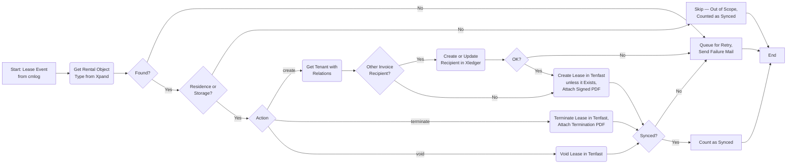
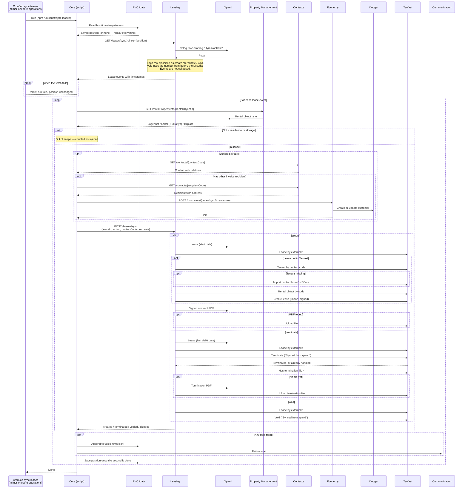

# Synka Avtal från Xpand

_Del av [processöversikten](../DOCS_Sync_Overview.md) för Xpand-synk. Där beskrivs det gemensamma — sparad position, felkö, återförsök, notifieringar, schemaläggning och vad som händer om något ligger nere — som inte upprepas här._

Ett fristående script (`core/src/scripts/sync-leases/index.ts`) speglar hyreskontrakt från Xpand till **Tenfast**. Så länge handläggare tecknar, säger upp och makulerar avtal i Xpand är Xpand sanningskällan; scriptet ser till att Tenfast hamnar i samma läge.

Till skillnad från [kontaktsynken](../sync-contacts/DOCS_Sync_Contacts.md), som bara uppdaterar befintlig data, **skapar** den här synken avtal i Tenfast — med hyresgäst, hyresrader och kontrakts-PDF — och avslutar dem.

Scriptet körs som CronJobbet `sync-leases` varje minut. Vid första körningen, utan sparad position, spelas hela Xpands historik upp.

## Vilka händelser som plockas upp

Leasing-tjänsten (`GET /leases/sync`) läser `cmlog`-rader som börjar med `Hyreskontrakt ` och klassificerar varje rad utifrån vilket fält som gått från tomt till ett datum:

| Fält som satts i Xpand | Action      | Vad som händer i Tenfast                          |
| ---------------------- | ----------- | ------------------------------------------------- |
| `Undertecknat`         | `create`    | Avtalet skapas, med hyresgäst, hyresrader och PDF |
| `Uppsagt datum`        | `terminate` | Avtalet sägs upp och uppsägnings-PDF:en bifogas   |
| `Makulerat datum`      | `void`      | Avtalet makuleras                                 |

- Bara `Bostadskontrakt`, `Lokalkontrakt` och `Garagekontrakt` tas med. Andra rader, och rader som saknar kontraktsnummer, kontaktkod eller något av fälten ovan, hoppas över utan loggning.
- Kontraktsnummer och kontaktkod läses ur radens första rad. Hyresobjektets kod är kontraktsnumret utan sista `/`-delen.
- Ett preliminärt uppsagt kontrakt triggar ingenting — bara när `Uppsagt datum` sätts.

**Makulerade avtal byter nummer i Xpand.** Kontraktsnumret får ett M-suffix i samma ändring (t.ex. `…/10` → `…/10M`), medan Tenfast känner avtalet under det gamla numret. Därför läses det ursprungliga numret ur raden `Värdet i fältet 'Kontraktsnummer' ändrat från … till …` i samma logg-post. Saknas den raden går makuleringen inte att koppla till rätt avtal: den loggas som varning och hoppas över helt.

**Händelser slås inte ihop.** Varje händelse spelas upp i ordning, så att ett avtal som både tecknats och sagts upp sedan förra körningen hamnar rätt i Tenfast — så länge varje steg lyckas. Av samma skäl stryker en nyare händelse inte en äldre som ligger i felkön.

**En senare händelse väntar inte på en köad.** Misslyckas tecknandet av ett avtal hamnar det i felkön, men en senare uppsägning eller makulering av samma avtal körs ändå. Avtalet finns inte i Tenfast än, så den räknas som lyckad och hoppas över — utan kö och utan mejl. Lyckas tecknandet senare blir följden olika:

- **Uppsägning:** Tenfast får ett aktivt avtal utan slutdatum, som Xpand har sagt upp, och fortsätter avisera det. Bekräftelsemejlet säger bara att avtalet nu är synkat.
- **Makulering:** tecknandet lyckas aldrig, eftersom avtalet bytt nummer i Xpand — se [Om samma händelse körs igen](#om-samma-händelse-körs-igen).

## Vilka objekt som är i scope

Innan något skickas till Tenfast hämtar Core hyresobjektets typ från Xpand via Property Management, för alla tre actions:

- **Lägenhet** — synkas.
- **Lokal** vars lokaltyp är **Förråd** — synkas.
- Allt annat, bland annat **Bilplats** och övriga lokaler — hoppas över. Raden loggas (`rental object type not in scope, skipping`) och räknas som lyckad.

Garagekontrakt plockas alltså upp ur loggen men faller bort här. Det är avsiktligt: bilplatser hanteras direkt i Tenfast — se [Uppsägning av Avtal](../../processes/leasetermination/DOCS_Overview.md).

Går objektinformationen inte att hämta räknas raden som ett **fel** och hamnar i felkön — till skillnad från "utanför scope". Det gäller även objekt av en sort som Property Management inte känner till: Xpand har en fjärde sort, Övrigt (`bahyr`), som ger ett serverfel i stället för "utanför scope". En sådan rad köas, mejlas och ges upp efter 30 dagar med rådet att göra ändringen i Tenfast — fast objektet aldrig skulle dit. Om Övrigt-objekt har bostads-, lokal- eller garagekontrakt i Xpand är inte kontrollerat.

## Annan fakturamottagare

Vid `create` hämtas hyresgästen från Contacts, med relationer. Har hen en **annan fakturamottagare** hämtas den kontakten i sin helhet och synkas till Xledger — **skapas** om kunden saknas. Mottagaren måste finnas som kund innan avtalet börjar aviseras, även om hen aldrig varit hyresgäst. Misslyckas det avbryts hela avtalssynken och raden köas. Undantag: avvisar Economy kunden med ett 4xx-svar räknas det som lyckat, och avtalet skapas utan att mottagaren blivit kund — se [processöversikten](../DOCS_Sync_Overview.md#att-känna-till).

God man och förvaltare läses men används inte av scriptet. De når Tenfast när hyresgästen importeras (se nedan), eftersom Tenfast då hämtar kontakten med relationer från ONECore.

## Vad som händer i Tenfast

### create — avtalet skapas

1. Avtalet läses i Xpand. Saknas det, eller saknar det startdatum, blir det fel (404 respektive 400) och raden köas.
2. Finns ett avtal med samma kontraktsnummer redan i Tenfast skapas inget nytt — steg 3–5 hoppas över.
3. Hyresgästen slås upp i Tenfast på kontaktkod. Saknas hen importeras hen från ONECore (`import-contact`).
4. Hyresobjektet slås upp i Tenfast. Saknas det blir det fel och raden köas.
5. Avtalet skapas som importerat och signerat (`method: "import"`, `signed: true`), med:
   - Xpands kontraktsnummer som `externalId` — nyckeln som `terminate` och `void` senare slår upp på,
   - startdatum från Xpand,
   - hyresrader kopierade från hyresobjektet i Tenfast,
   - månadsavisering, två veckor i förskott.
6. Det signerade kontraktet hämtas som PDF ur Xpands dokumentarkiv och laddas upp på avtalet. **Det här steget kan inte fälla synken** — saknas PDF:en eller misslyckas uppladdningen loggas en varning, men avtalet räknas som skapat. Raden köas inte, så PDF:en saknas sedan i Tenfast tills någon laddar upp den för hand.

### terminate — avtalet sägs upp

1. Avtalet läses i Xpand för att få sista debiteringsdatum. Saknas avtalet eller datumet blir det fel och raden köas.
2. Avtalet slås upp i Tenfast. Finns det inte räknas raden som lyckad — typiskt ett avtal som aldrig kom in i Tenfast.
3. Avtalet sägs upp med sista debiteringsdatum som slutdatum, `reason: "Synced from xpand"`, utan avisering till hyresgästen och markerat som redan hanterat.
4. Två svar från Tenfast räknas också som lyckade, utan mejl:
   - `Avtalet kan inte sägas upp` — avtalet är redan uppsagt.
   - `Avtalet kommer löpa ut inom uppsägningstiden. Ingen uppsägning krävs.` — Tenfast ger det när avtalet ändå tar slut inom uppsägningstiden (så används svaret i hyresgästens egen uppsägning), och det kan komma redan första gången. Exakt vad Tenfast jämför med är inte verifierat. **Xpands sista debiteringsdatum förs då inte över**: är det tidigare än Tenfasts slutdatum aviserar Tenfast för länge.
5. Uppsägningshandlingen bifogas. Det görs både efter en lyckad uppsägning och när avtalet redan var uppsagt:
   - Har avtalet redan en uppsägningsfil i Tenfast händer inget mer.
   - Annars hämtas den senaste uppsägnings-PDF:en ur Xpands dokumentarkiv och laddas upp.
   - **Det här steget kan inte fälla synken** — varje fel loggas som varning. Raden köas inte och ingen senare körning tittar på den igen, så en PDF som saknades eller inte gick att ladda upp får läggas in i Tenfast för hand.

### void — avtalet makuleras

1. Avtalet slås upp i Tenfast på det ursprungliga kontraktsnumret. Finns det inte räknas raden som lyckad.
2. Avtalet makuleras med `reason: "Synced from xpand"`.
3. Varje annat svar än OK är ett fel. Till skillnad från uppsägning finns inget undantag för ett avtal som redan är avslutat.

## Om samma händelse körs igen

En händelse kan köras om — från felkön, efter en krasch mitt i en sekund, eller efter att PVC:n tömts. Utfallet skiljer sig per action:

| Action                                                                 | Vid omkörning                                                                                                                                                                                                                                                                                                                                                                                                                                                                                                                                                     |
| ---------------------------------------------------------------------- | ----------------------------------------------------------------------------------------------------------------------------------------------------------------------------------------------------------------------------------------------------------------------------------------------------------------------------------------------------------------------------------------------------------------------------------------------------------------------------------------------------------------------------------------------------------------- |
| `create`                                                               | Inget dubbelavtal skapas. Den signerade PDF:en laddas däremot upp en gång till.                                                                                                                                                                                                                                                                                                                                                                                                                                                                                   |
| `terminate`                                                            | Ofarligt. Svaret `Avtalet kan inte sägas upp` räknas som lyckat, och uppsägnings-PDF:en laddas inte upp igen om den redan finns. Saknades PDF:en förra gången försöks den nu igen — det enda sättet den kommer in utan handpåläggning.                                                                                                                                                                                                                                                                                                                            |
| `void`                                                                 | **Kan misslyckas.** Det finns inget skydd mot en andra makulering: varje svar från Tenfast utom OK är ett fel. Avvisar Tenfast den köas raden och försöks igen i 30 dagar innan den ges upp. Hur Tenfast faktiskt svarar på en andra makulering är inte verifierat.                                                                                                                                                                                                                                                                                               |
| `create` eller `terminate` för ett avtal som **makulerats sedan dess** | **Misslyckas i 30 dagar.** Makuleringen gav avtalet ett nytt nummer i Xpand (`…/10M`), men tecknande och uppsägning slår upp det gamla (`…/10`). Leasing hittar inget avtal och svarar 404, innan Tenfast ens tillfrågas. Raden köas, mejlas och ges upp med rådet att göra ändringen i Tenfast för hand. **Gör inte det** — avtalet är makulerat. Har Xpand återanvänt numret (t.ex. `…/09M2`) kan uppslaget i stället träffa ett nyare avtal. Det händer vid första körningen, efter en tömd PVC, eller när ett köat tecknande försöks igen efter makuleringen. |

## Flödesdiagram

Processens beslutslogik för en händelse. System- och integrationsdetaljer är medvetet utelämnade här — se sekvensdiagrammet nedan för det. Kö och sparad position finns i [processöversiktens flödesdiagram](../DOCS_Sync_Overview.md#gemensamt-flödesdiagram).

## Sekvensdiagram

Vilka tjänster som anropas i varje steg, i vilken ordning. Det här är ett fristående, schemalagt script — inte en HTTP-endpoint initierad av en människa. Kön gås igenom med samma anropskedja och är utelämnad här.

## Att känna till

- **Bilplatser synkas aldrig här**, varken tecknande, uppsägning eller makulering — se [Vilka objekt som är i scope](#vilka-objekt-som-är-i-scope).
- **En makulering som körs om kan fastna.** Se [Om samma händelse körs igen](#om-samma-händelse-körs-igen). Ger synken upp efter 30 dagar är rådet i mejlet att göra ändringen i Tenfast för hand — kontrollera först om avtalet redan är makulerat där.
- **Senare ändringar av avtalet följer inte med.** Synken reagerar bara på de tre fälten ovan. Ändras t.ex. hyra eller hyresgäst i Xpand efter att avtalet skapats når det inte Tenfast.
