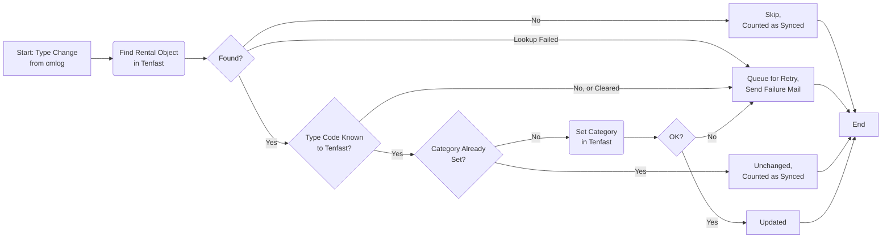
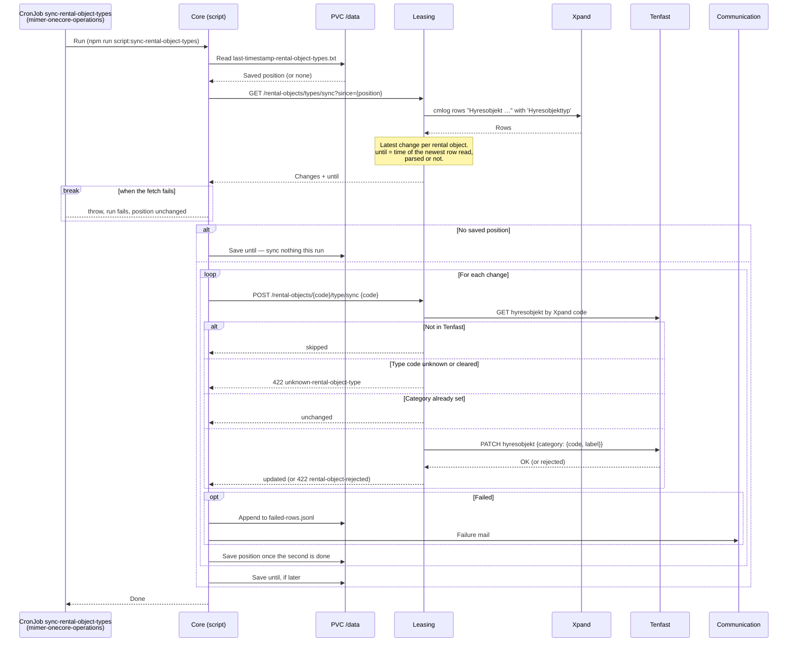

# Synka Hyresobjektstyp från Xpand

_Del av [processöversikten](../DOCS_Sync_Overview.md) för Xpand-synk. Där beskrivs det gemensamma — sparad position, felkö, återförsök, notifieringar, schemaläggning och vad som händer om något ligger nere — som inte upprepas här._

Ett fristående script (`core/src/scripts/sync-rental-object-types/index.ts`) för över ändrade hyresobjektstyper från Xpand till **Tenfast**. När en handläggare byter typ på ett hyresobjekt i Xpand — t.ex. från `STD Standard hyresobjektstyp` till `POÄNGFRITT Poängfritt` — sätts motsvarande kategori på hyresobjektet i Tenfast.

Scriptet körs som CronJobbet `sync-rental-object-types` varje minut. Vid första körningen, utan sparad position, synkas **ingenting**: scriptet sparar tidpunkten för den senaste ändringen och börjar därifrån. Typer som ändrats innan jobbet startades förs alltså inte över.

## Vilka ändringar som plockas upp

Leasing-tjänsten (`GET /rental-objects/types/sync`) läser `cmlog`-rader som börjar med `Hyresobjekt ` och innehåller fältet `Hyresobjekttyp`, t.ex.:

```
Hyresobjekt 807-033-01-0101
 Värdet i fältet 'Hyresobjekttyp' ändrat från 'STD Standard hyresobjektstyp' till 'POÄNGFRITT Poängfritt'.
```

- Hyresobjektets kod läses ur första raden.
- Typkoden är första ordet i det nya värdet (`POÄNGFRITT`). Resten (`Poängfritt`) används inte — benämningen i Tenfast tas från en fast tabell, se nedan.
- Har typen tömts (`till ''`) blir typkoden tom.
- Har samma hyresobjekt ändrats flera gånger sedan förra körningen synkas bara den senaste ändringen.
- Rader som inte går att tolka hoppas över med en varning i loggen.

Leasing svarar också med tidpunkten för den senaste rad den läst, även om raden inte gick att tolka. Den sparas som position, så en rad som inte går att tolka läses inte om varje minut. Samma luckor som för de andra synkarna gäller: rader i samma sekund som den senast lästa, och rader från timmen som upprepas när klockan ställs tillbaka, kan tappas — se [processöversikten](../DOCS_Sync_Overview.md#cmlog-som-ändringskälla).

## Vilka objekt som är i scope

Alla hyresobjekt — lägenheter, lokaler och bilplatser — så länge de finns i Tenfast. Det finns inget filter på objekttyp, till skillnad från [avtalssynken](../sync-leases/DOCS_Sync_Leases.md#vilka-objekt-som-är-i-scope).

## Vad som händer i Tenfast

1. Hyresobjektet slås upp i Tenfast på Xpands objektkod. **Finns det inte hoppas ändringen över** och räknas som lyckad.
2. Typkoden slås upp i tabellen över Tenfasts kategorier (`rental-object-categories.ts`, kopierad från Tenfasts API-dokumentation). En tom typkod, eller en kod som inte finns i tabellen, är ett **fel**.
3. Har hyresobjektet redan den kategorin i Tenfast görs ingenting.
4. Annars sätts kategorin — kod och benämning från tabellen — på hyresobjektet.

Tabellen innehåller 25 koder:

`55PLUS`, `ANPASSAD`, `AVS`, `BLOCK`, `BOKOMP`, `CO-LIVING`, `DELABOSTAD`, `EXTERN`, `FÖRHAN`, `G-LOKAL`, `KOMMERS`, `KOMMERSM`, `KOOPHYRES`, `KORTTID`, `NATT`, `NYPROD`, `POÄNGFRITT`, `RENOVERAD`, `SAMLOKAL`, `SERV`, `SNABB`, `STD`, `STUD`, `TRYGG`, `UNGDOM`

## Felhantering

Alla fel behandlas lika: raden läggs i felkön, ett mejl skickas och raden försöks igen enligt [processöversikten](../DOCS_Sync_Overview.md#felkö-och-återförsök). Det gäller även fel som inte går över av sig själva:

| Orsak                                        | Går över av sig själv?                                           |
| -------------------------------------------- | ---------------------------------------------------------------- |
| Tenfast eller Leasing svarar inte            | Ja, när systemet är uppe igen                                    |
| Tenfast avvisar ändringen                    | Troligen inte                                                    |
| Typkoden finns inte i tabellen, eller är tom | Nej — bara om typen ändras igen i Xpand, eller tabellen byggs ut |

**En nyare ändring ersätter en köad.** Byts typen igen på samma hyresobjekt stryks den gamla ändringen ur kön och ett mejl skickas. Utan det skulle en gammal ändring som till slut lyckas kunna sätta tillbaka den gamla typen i Tenfast. Ger synken upp efter 30 dagar är rådet i mejlet att göra ändringen i Xpand på nytt.

Ligger en ändring i kön och hyresobjektet sedan inte finns i Tenfast stryks den ur kön med ett mejl om att den inte synkades.

## Flödesdiagram

Processens beslutslogik för en ändring. System- och integrationsdetaljer är medvetet utelämnade här — se sekvensdiagrammet nedan för det. Kö och sparad position finns i [processöversiktens flödesdiagram](../DOCS_Sync_Overview.md#gemensamt-flödesdiagram).



## Sekvensdiagram

Vilka tjänster som anropas i varje steg, i vilken ordning. Det här är ett fristående, schemalagt script — inte en HTTP-endpoint initierad av en människa. Kön gås igenom med samma anropskedja och är utelämnad här.



## Att känna till

- **Koder som saknas i Tenfasts tabell försöks igen i 30 dagar.** I testdata finns minst `HDK` och `DIREKT`, som inte finns i tabellen. En sådan ändring kan inte lyckas förrän tabellen byggs ut, men köas och mejlas ändå som vilket fel som helst — och ges upp efter 30 dagar.
- **En tömd typ förs inte över.** Tenfast får aldrig en tom kategori; ändringen blir ett fel.
- **Ingen historik förs över.** Typer som ändrades innan jobbet startade första gången — eller medan PVC:n var borta — ligger kvar i Tenfast som de var.
- **Benämningen kommer från tabellen**, inte från Xpand. Byter Xpand namn på en typ men behåller koden syns det inte i Tenfast.
