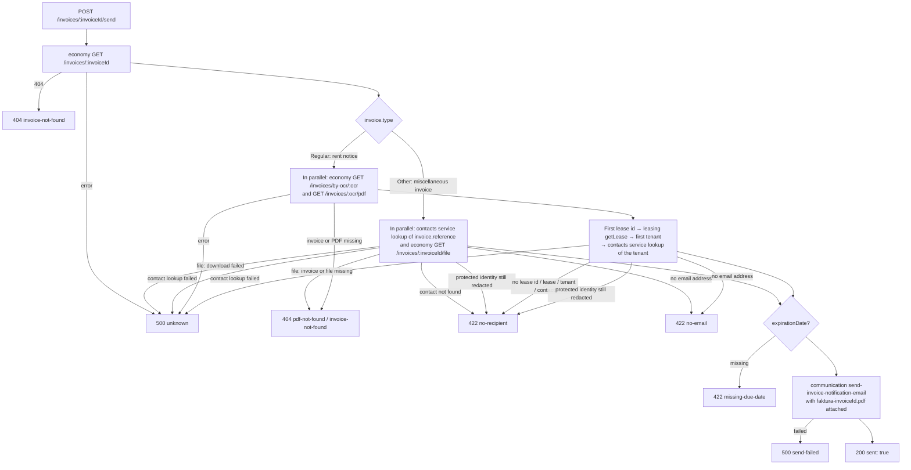

# Download and email an invoice

Invoices in the tenant ledger (property-tree) can be downloaded and emailed to the customer.

- **Download rent notice**: `GET /invoices/{ocr}/pdf`. Shown when the invoice has `hasRentNoticePdf`, which economy sets on invoices found in the rent system with an OCR number. Miscellaneous invoices keep their own "Se PDF" link (`invoiceFileUrl`). Invoices from the old system have no PDF.
- **Email invoice**: `POST /invoices/{invoiceId}/send`. Works for rent notices with a PDF and for miscellaneous invoices with a ledger file.

`POST /invoices/notify-batch` runs the same rent notice branch (`sendRentNoticeEmail`) for many OCR numbers. It reports failures as strings in `failed[]`, the same strings as before (`toNotifyBatchError`); a tenant whose protected identity is still redacted is reported as `protected-identity`.

Both branches take the recipient from the contacts service (`tenantAwareContactLookup`), never from leasing, and fail closed: a protected identity that is not revealed is not emailed. The email goes to the primary address, falling back to the first one. The greeting uses the first name (full name if missing) of a person, or the name of an organisation.

Outside production every email goes to `config.emailAddresses.tenantDefault`.

## Email flow

404 and 422 are logged at `warn` by the route. 500s are logged by the adapter that failed.

## Miscellaneous invoice PDF

Economy `GET /invoices/{invoiceNumber}/file` looks up the invoice in the ledger. It downloads `invoiceFile.url` server-side, without the ledger API token, because the link opens without a login. It answers 404 `{ reason: invoice-not-found | file-not-found }`.
