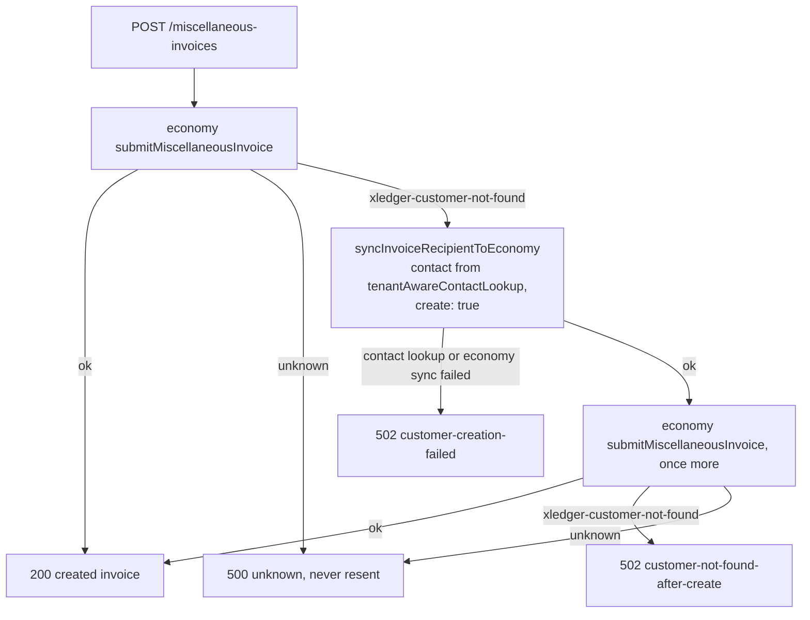

# Submit a miscellaneous invoice

Staff create a miscellaneous invoice (ströfaktura) in property-tree with `POST /miscellaneous-invoices`, a multipart body with the invoice as JSON in `invoice` and the supporting document in `attachment`. The route calls `submitMiscellaneousInvoiceCreatingCustomer`.

A tenant whose only lease has not started yet is often not a customer in the ledger. When the ledger answers that the customer is missing, core creates the customer from the contacts service and sends the invoice once more.

## Flow

The contact is read through `tenantAwareContactLookup`, so a protected identity is revealed only for a tenant. A protected contact who is not a tenant is created with its redacted details.

The invoice is sent again only after the ledger has definitely said the customer is missing. An unknown outcome may mean the invoice was written, so it is never resent.

`customer-not-found-after-create` means the customer was created but the ledger does not see it yet; staff can try again.

## What property-tree shows

The form is only sent with the send button; Enter in a field does not submit it.

While the invoice basis is being sent (from merging the attachments until the response arrives), leaving the page asks for confirmation first: a dialog for navigation within property-tree, and the browser's own prompt for reload or closing the tab. Leaving would lose the receipt or the unknown-outcome warning below, even though the invoice may still be created.

- **200**: a receipt with customer, lease and amount replaces the form until staff choose to create a new invoice.
- **4xx, `customer-creation-failed`, `customer-not-found-after-create`**: the invoice was not sent. A toast explains why and the form keeps its values.
- **500 `unknown`, any other 5xx, network failure or timeout**: the invoice may have been created. A persistent warning at the top of the form names the customer, lease and amount and asks staff to check the list of miscellaneous invoices or with the finance team before sending again. It never says "try again", and nothing is resent automatically. The warning stays when the form is cleared and goes away only when staff send again.
