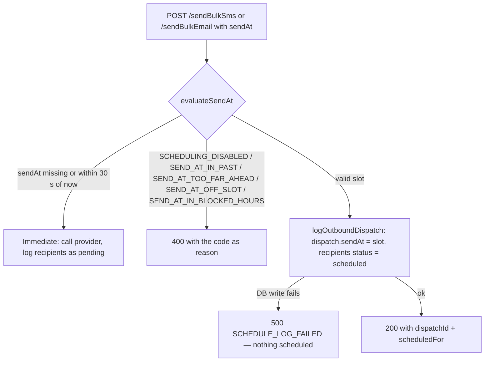
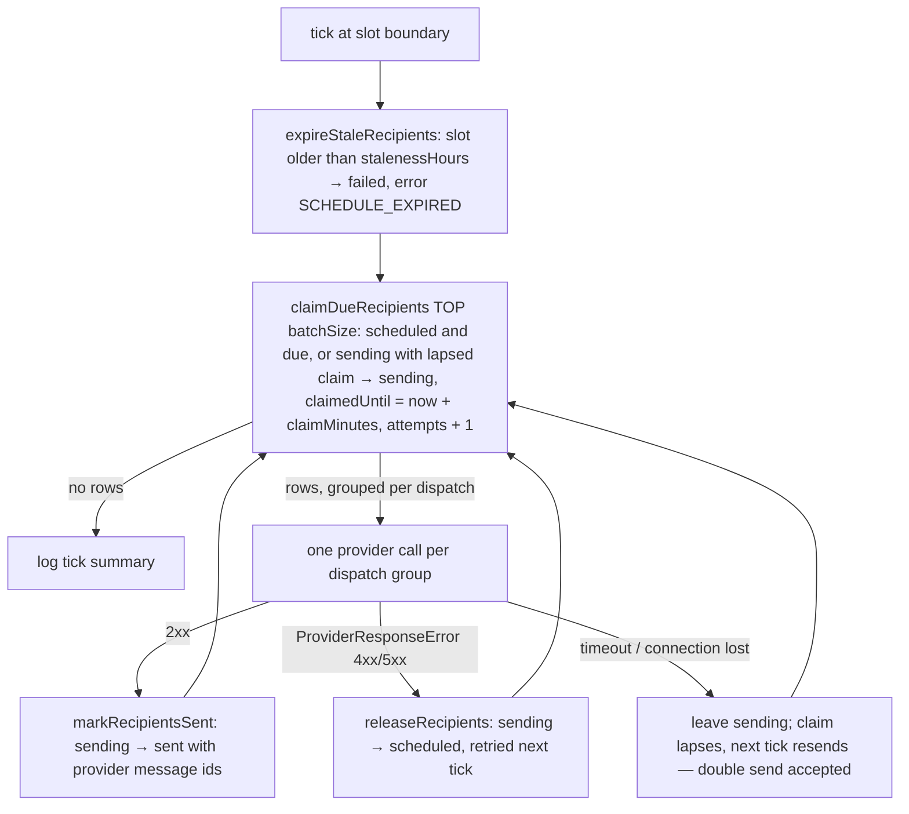

# Scheduled sends (SMS/email)

Scheduled messages are stored in the communication database and sent by an
in-process worker in this service. The provider (Infobip for email, Tele2's
Infobip instance for SMS) only ever receives immediate sends. Replaces the
Infobip-side scheduling of MIM-1897 (see MIM-1838).

Why not let Infobip schedule: the Tele2-procured SMS key lacks the
bulk-management permissions behind cancel/reschedule (PUT /sms/1/bulks 403s),
Infobip email refuses schedules more than 5 days ahead, and both instances
accept a reschedule to an _earlier_ time with 200 but still fire at the old
time (verified live 2026-07-27). Owning the schedule also makes the provider
a plain "send now" call, so switching providers later touches one step.

## Scheduling a send



Rules (`rules.ts`, Swedish local time, Europe/Stockholm):

- `sendAt` must be a 10-minute slot boundary (:00, :10, …, :50), in the
  future, within `scheduledSends.maxDaysAhead` (default 30) and outside the
  daily blocked window `scheduledSends.blockedFrom`–`blockedUntil`
  (default 21:00–07:00, same for both channels).
- With `scheduledSends.enabled` off (the default when the env var is missing)
  every `sendAt` is rejected with `SCHEDULING_DISABLED`; immediate sends are
  unaffected. `GET /communication-log/schedule-config` exposes the rules
  (and the flag) so the frontend picker mirrors them.

## The worker (`worker.ts`)

Started from `src/index.ts` when `scheduledSends.enabled` is true. Every
replica runs it; the atomic claim keeps them from colliding, so there is no
leader election and no extra pods.

- Chained `setTimeout` to the next open 10-minute slot boundary (never
  `setInterval`), so a slow tick can't overlap the next. During blocked hours
  the timer targets the first open slot (07:00), so retries never send into
  the window.
- On SIGTERM the loop stops claiming, lets the in-flight provider call finish
  (bounded by `providerTimeoutMs`, default 20 s, under Kubernetes' 30 s grace)
  and the process exits.

### One tick



- The claim is one `UPDATE … WITH (UPDLOCK, READPAST, ROWLOCK) … OUTPUT`
  statement: two replicas can never both get the same row.
- Every status write after a claim is fenced on `attempts` (the claim
  incremented it), so a slow worker can't overwrite a row another worker
  re-claimed.
- Worker stopping mid-batch: groups not yet sent are released straight back to
  `scheduled` so another replica takes them at the next tick.

### Status flow

```
scheduled ──claim──▶ sending ──provider 2xx──▶ sent ──delivery reports──▶ delivered / failed / bounced
    ▲                  │
    └──provider 4xx/5xx┘   (retry at next tick)
    └──claim lapsed────┘   (worker died; resend — double send accepted)

scheduled/sending (claim lapsed), slot older than stalenessHours ──▶ failed, error SCHEDULE_EXPIRED
scheduled ──cancel──▶ cancelled
```

Staleness (default 3 h) bounds every retry path: repeated provider refusals,
an outage, or a send scheduled at 20:50 that fails and can't retry until
07:00 all end as `failed`, logged once with `logger.error` (ids only).

Accepted edge cases, mirroring "an occasional double send beats a missed
send": a row whose provider call succeeded but whose `markRecipientsSent`
kept failing is resent when the claim lapses, and if that keeps happening it
ends as `failed` after the staleness window although it was delivered.

Turning the flag off stops both the claim and the expiry: rows already
`scheduled` stay put (the dispatch derivation shows them as `sending` once
their slot passes) until the flag is on again or they are cancelled from the
UI. Only turn it off when nothing is scheduled; startup logs a `warn` with
the count of open rows when it is off.

## Cancel and reschedule

Pure DB updates, SMS and email alike:

- `POST /communication-log/dispatches/:id/cancel` sets the still-`scheduled`
  recipients to `cancelled` and returns the count; allowed on a partly
  processed dispatch. Already cancelled → 200 with 0. No `scheduled` rows left
  (or the worker took the last one between read and write) → 409
  `ALREADY_PROCESSED`.
- `POST /communication-log/dispatches/:id/reschedule` moves `dispatch.sendAt`
  earlier or later, validated by the same rules (400 codes as above, plus
  `SEND_AT_TOO_SOON` for a time within the grace window). Only while every
  recipient is still `scheduled`/`cancelled`: a claimed or sent recipient → 409
  `ALREADY_PROCESSED`, since moving an overdue dispatch would reset its
  staleness clock. The update is conditional on the recipient statuses, so it
  is atomic against the claim.

## Observability

- One `info` line per tick: `scheduled-sends tick` with
  `{ expired, claimed, sent, retried, unknown, released, durationMs }`. Alert
  in Elasticsearch when none has been logged for a while during open hours.
- `warn` per refused/unknown batch (dispatch id, count, attempt), and one
  `logger.error` when recipients expire. Never phone numbers or addresses.

## Config (`src/common/config.ts`, env prefix `SCHEDULED_SENDS__`)

| key                 | default | meaning                                       |
| ------------------- | ------- | --------------------------------------------- |
| `enabled`           | false   | run the worker and accept `sendAt`            |
| `blockedFrom`       | 21:00   | start of the daily no-send window (local)     |
| `blockedUntil`      | 07:00   | end of the window (exclusive)                 |
| `maxDaysAhead`      | 30      | max days ahead for `sendAt`                   |
| `stalenessHours`    | 3       | unsent this long after the slot → failed      |
| `batchSize`         | 500     | recipients per provider call                  |
| `claimMinutes`      | 5       | claim expiry; must exceed `providerTimeoutMs` |
| `providerTimeoutMs` | 20000   | abort the provider call after this            |
