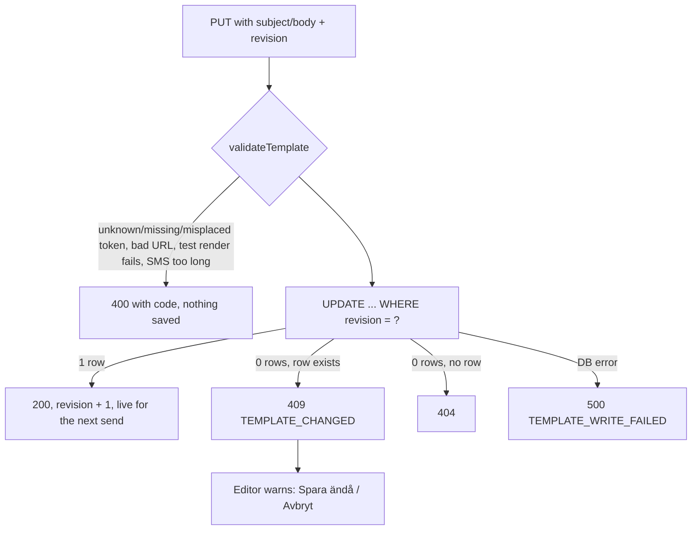
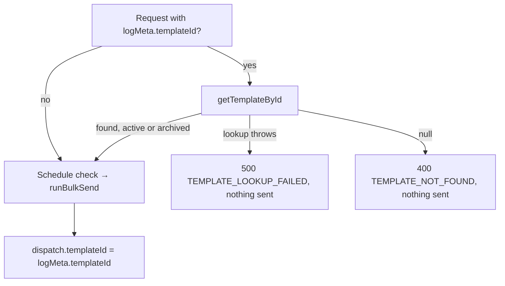
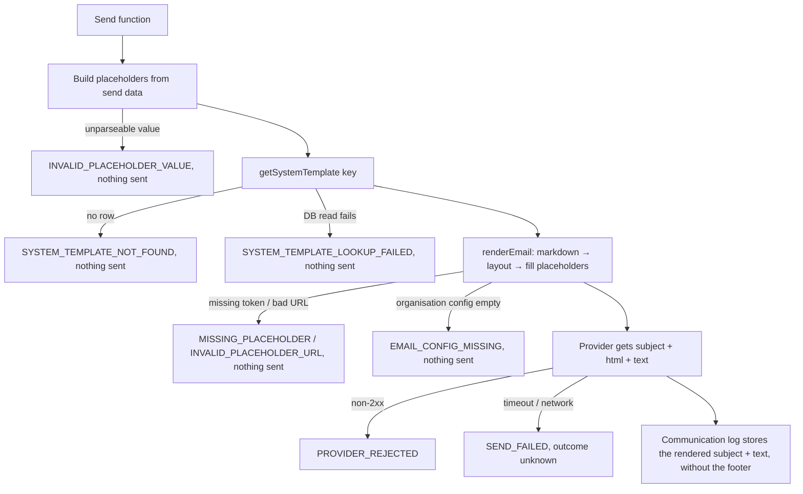

# Message templates

Two kinds of template share the `template` table and one visual editor on `/mallar` in property-tree (MIM-2291):

- **Rep templates (SMS):** starting texts reps pick in the SMS modal and edit freely before sending. The log records which template a message started from; editing or archiving a template never changes sent text.
- **System templates (email):** the emails ONECore sends by itself, looked up by `systemKey`. The comms team edits them; a save is live for the next send.

Every body is **markdown**. The editor shows it formatted and never shows the markdown. A template's SMS text is its markdown with the formatting stripped (`markdownToText` in `render/render.ts`: bold disappears, links become `text (url)`, fact rows `label: value`, lists keep `- ` / `1. `, placeholders stay `{{token}}`, also as an address, which only the send checks once filled). Rep templates expose it as `smsText`, and the SMS modal pastes that, never `body`.

## Table

- `template` (`202606081000_create_template_table.js`): `name`, `body`, `channels` (rep `sms`, system `email`), `subject` (system only), `isActive` (BIT; 0 = archived, renamed from `status` in `202611061100_rename_template_status_to_is_active.js`), `systemKey`, `revision`, `updatedBy`, `createdAt`, `updatedAt`.
- `revision` and `updatedBy` come from `202611261000_template_revision_and_markdown_bodies.js`, which also escaped the existing rep bodies (`escapePlainText`) so their SMS text stayed exactly what it was as plain text.
- Unique active names: filtered index `uq_template_active_name` (`WHERE isActive = 1 AND systemKey IS NULL`). The route maps MSSQL error 2601/2627 to `409 TEMPLATE_NAME_TAKEN`; no check-then-write.
- Archive instead of delete; `dispatch.templateId` has a FK to `template.id`. System templates can never be archived or deleted.
- Log reads LEFT JOIN `template` and expose `templateName` (current name). Renaming relabels history; `dispatch.body` is untouched.
- The DB is the source of all template text. The seed files in `migrations/system-email-templates/` are frozen migration data, only where the system templates started.

## Saving

Every create and update (rep and system) runs `validateTemplate` (`validation.ts`) before anything is written, and the editor's preview runs it too. Nothing that would fail or go out broken at send time can be saved. Each failure is a `400` with a code:

| Code                                              | When                                                                                                     |
| ------------------------------------------------- | -------------------------------------------------------------------------------------------------------- |
| `UNKNOWN_PLACEHOLDER`                             | a `{{token}}` the send doesn't supply (rep templates have none yet, MIM-2289)                            |
| `MISSING_REQUIRED_PLACEHOLDER`                    | a required token is gone (`message` on the two work-order emails)                                        |
| `PLACEHOLDER_NOT_ALONE`                           | a `block` token (the work-order `message`, sanitized HTML) not alone in its paragraph, or in the subject |
| `INVALID_URL`                                     | a typed-in link not `https:`/`mailto:`/`tel:`, or image not `https:`                                     |
| `MISSING_PLACEHOLDER` / `INVALID_PLACEHOLDER_URL` | the test render with example values failed, e.g. a text placeholder used as an address                   |
| `SMS_TEXT_TOO_LONG`                               | rep template whose SMS text is over 1600 characters (the markdown may be longer)                         |

Concurrent saves: an update sends the `revision` it loaded. The UPDATE itself has `WHERE revision = ?` and sets `revision + 1`, so two saves can't both land; zero rows answers `409 TEMPLATE_CHANGED` (or `404` when the row is gone). The editor then shows who saved when and offers "Spara ändå" (resubmit at the current revision) or "Avbryt" (keep the text in the editor). Core stamps `updatedBy` from the token.

## Routes

Rep templates:

| Method | Path                                              | Notes                                                                                                        |
| ------ | ------------------------------------------------- | ------------------------------------------------------------------------------------------------------------ |
| GET    | `/message-templates?status=active\|archived\|all` | default `active`, alphabetical                                                                               |
| GET    | `/message-templates/:id`                          | 404 `TEMPLATE_NOT_FOUND`                                                                                     |
| POST   | `/message-templates`                              | 201; 400 validation codes; 409 `TEMPLATE_NAME_TAKEN`                                                         |
| PUT    | `/message-templates/:id`                          | `revision` required; 400 `NO_FIELDS` / validation codes; 404; 409 `TEMPLATE_NAME_TAKEN` / `TEMPLATE_CHANGED` |
| POST   | `/message-templates/preview`                      | `{ body }` → `{ text }`, the SMS text for the editor (not capped)                                            |
| POST   | `/message-templates/:id/archive`                  | 404                                                                                                          |
| POST   | `/message-templates/:id/restore`                  | 404, 409                                                                                                     |

System templates (`system-routes.ts`); the key is the identifier, the same in every environment:

| Method | Path                             | Notes                                                                                                        |
| ------ | -------------------------------- | ------------------------------------------------------------------------------------------------------------ |
| GET    | `/system-templates`              | adds `placeholders` (token, Swedish label, kind, required, example), `logoUrl`, `footerLines` for the editor |
| GET    | `/system-templates/:key`         | 404 `SYSTEM_TEMPLATE_NOT_FOUND`                                                                              |
| PUT    | `/system-templates/:key`         | `{ subject, body, revision }`; 400 validation codes; 404; 409 `TEMPLATE_CHANGED`                             |
| POST   | `/system-templates/:key/preview` | the finished email with example values; 500 `EMAIL_CONFIG_MISSING` when the organisation config is empty     |

Core proxies both. Rep routes need only the login. For system templates the GETs need only the login and return `capabilities.canEdit`; PUT and preview need the realm role `system-message-templates:write` (core `requireRole`, 403 otherwise). There are no create, archive or delete routes for system templates.

## Send flow (`POST /sendBulkSms`)

An archived id still sends and links: the text really did start from that template, and the FK holds.

## System templates (email)

Emails the code sends (parking space offers, work orders, invoices, inspection protocols, lease termination) live in the same `template` table, identified by `systemKey` (`202611251000_add_system_templates.js`). Code looks them up by key with `getSystemTemplate`, because ids differ between environments; a send always reads the latest saved row.

- `systemKey` is nullable with a filtered unique index (`uq_template_system_key`, `WHERE systemKey IS NOT NULL`). `uq_template_active_name` now only covers rep templates (`AND systemKey IS NULL`), so a rep template may reuse a system template's name.
- The `/message-templates` routes never see system rows: list, get, update, archive and restore all filter `systemKey IS NULL`, so a system id answers 404.
- Placeholders per key: `SYSTEM_TEMPLATE_PLACEHOLDERS` in `system-templates.ts`, the tokens each send always supplies. A test keeps it equal to the keys of `SYSTEM_EMAIL_FIXTURES`, which run example payloads through the real builders and give the preview's example values. Stopgap until MIM-2289.
- Rendering (`system-templates.ts` → `render/`): markdown → inline-styled HTML fragment + plain text, wrapped in one layout with the same contact footer for every email (visiting address, email, phone, privacy policy). Organisation details come from config `organisation`; an empty one stops the send with `EMAIL_CONFIG_MISSING`.
- Placeholders `{{token}}` are filled after markdown parsing, so a value is never read as markdown; values are HTML-escaped. A placeholder used as a link or image address must resolve to `https:` (links also `mailto:`/`tel:`) or rendering throws `INVALID_PLACEHOLDER_URL`. A token with no value throws `MISSING_PLACEHOLDER` before anything is sent. Send data that can't be turned into values (e.g. an unparseable date) throws `INVALID_PLACEHOLDER_VALUE`, also before anything is sent.
- One exception to escaping: a `TrustedHtml` value (`render/trusted-html.ts`) alone in its paragraph goes in as HTML. It is sender-written HTML cleaned by `sanitize-html` to an allowlist (`p`, `div`, `br`, `strong`/`b`, `em`/`i`, `u`, lists, `a` with `https:`/`mailto:`/`tel:`), with our inline styles replacing the sender's attributes, all inside one styled block; scripts, styles, images and iframes are dropped, and any other link (`http:`, relative, …) becomes `text (url)` text. Only `TrustedHtml.fromUntrusted` creates one, so a plain string is never inserted unescaped. Used for the Odoo work-order message (contractors write it too). The work-order SMS goes through the same cleaning and uses its plain text, where links read `text (url)`. The text conversion only ever sees sanitized HTML, so its regexes stay linear on hostile input.
- Preview script: `pnpm exec ts-node src/services/template-service/preview.ts` writes `build/email-previews/<systemKey>.html/.txt` from the templates in the DB (as sent) and the fixtures; run migrations first.

## Editor (property-tree)

`features/message-templates/ui/TemplateEditor.tsx`, TipTap with `@tiptap/markdown`; the document is `lib/editor/extensions.ts`. Headings come in two looks: `##` "Rubrik" (20px teal) and `###` "Underrubrik" (16px teal); the renderer gives `#` the first look and deeper levels the second. Three pieces are our own, each covered by `markdownRoundTrip.test.ts` (which also round-trips all ten seeds):

- `placeholderMark.ts`: a placeholder is a mark on the literal text `{{token}}`, not a node, so bold and links around it survive. A plugin keeps it whole while typing.
- `factTable.ts`: table cells are written on one line with `|` escaped; the empty header row is hidden in the editor.
- `escapedParagraph.ts`: the stock writer doesn't escape block markers at a line start, so text like `1. Ta med` would come back as a list.
