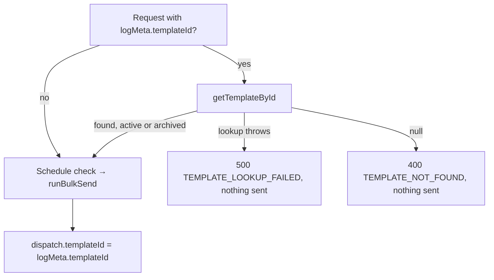

# Message templates (SMS)

Prefilled starting texts reps pick in the property-tree SMS modal and edit freely before sending. The log records which template a message started from; editing or archiving a template never changes sent text.

- Table: `template` (`202606081000_create_template_table.js`). First version uses `name`, `body`, `channels` (always `sms`), `isActive` (BIT; 0 = archived, renamed from `status` in `202611061100_rename_template_status_to_is_active.js`), `createdAt`, `updatedAt`.
- Unique active names: filtered index `uq_template_active_name` (`WHERE isActive = 1`). The route maps MSSQL error 2601/2627 to `409 TEMPLATE_NAME_TAKEN`; no check-then-write.
- Archive instead of delete; `dispatch.templateId` has a FK to `template.id`.
- Log reads LEFT JOIN `template` and expose `templateName` (current name). Renaming relabels history; `dispatch.body` is untouched.

## Send flow (`POST /sendBulkSms`)

An archived id still sends and links: the text really did start from that template, and the FK holds.

## Routes

| Method | Path                                              | Notes                          |
| ------ | ------------------------------------------------- | ------------------------------ |
| GET    | `/message-templates?status=active\|archived\|all` | default `active`, alphabetical |
| GET    | `/message-templates/:id`                          | 404 `TEMPLATE_NOT_FOUND`       |
| POST   | `/message-templates`                              | 201; 409 `TEMPLATE_NAME_TAKEN` |
| PUT    | `/message-templates/:id`                          | 400 `NO_FIELDS`, 404, 409      |
| POST   | `/message-templates/:id/archive`                  | 404                            |
| POST   | `/message-templates/:id/restore`                  | 404, 409                       |

Core proxies the same paths (`core/src/services/communication-service/message-templates.ts`).
