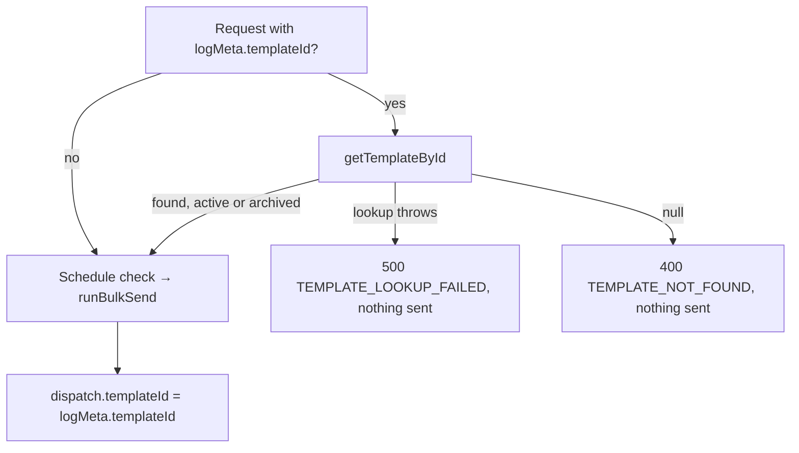
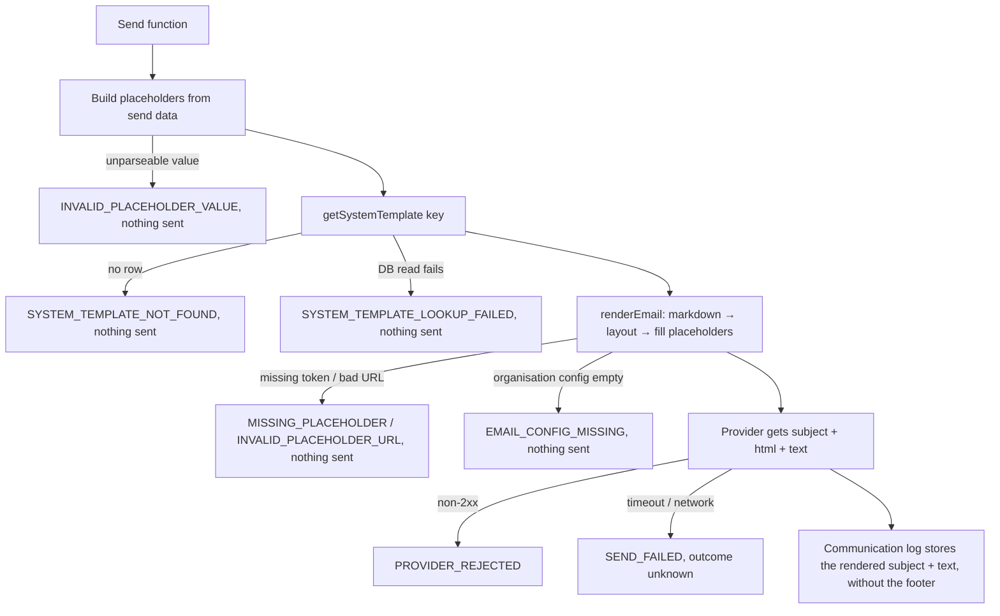

# Message templates (SMS)

Prefilled starting texts reps pick in the property-tree SMS modal and edit freely before sending. The log records which template a message started from; editing or archiving a template never changes sent text.

- Table: `template` (`202606081000_create_template_table.js`). Rep templates use `name`, `body`, `channels` (always `sms`; system templates are `email`, see below), `isActive` (BIT; 0 = archived, renamed from `status` in `202611061100_rename_template_status_to_is_active.js`), `createdAt`, `updatedAt`.
- Unique active names: filtered index `uq_template_active_name` (`WHERE isActive = 1 AND systemKey IS NULL`). The route maps MSSQL error 2601/2627 to `409 TEMPLATE_NAME_TAKEN`; no check-then-write.
- Archive instead of delete; `dispatch.templateId` has a FK to `template.id`.
- Log reads LEFT JOIN `template` and expose `templateName` (current name). Renaming relabels history; `dispatch.body` is untouched.

## Send flow (`POST /sendBulkSms`)

An archived id still sends and links: the text really did start from that template, and the FK holds.

## Routes

| Method | Path                                              | Notes                          |
| ------ | ------------------------------------------------- | ------------------------------ |
| GET    | `/message-templates?status=active\|archived\|all` | default `active`, alphabetical |
| GET    | `/message-templates/:id`                          | 404 `TEMPLATE_NOT_FOUND`       |
| POST   | `/message-templates`                              | 201; 409 `TEMPLATE_NAME_TAKEN` |
| PUT    | `/message-templates/:id`                          | 400 `NO_FIELDS`, 404, 409      |
| POST   | `/message-templates/:id/archive`                  | 404                            |
| POST   | `/message-templates/:id/restore`                  | 404, 409                       |

Core proxies the same paths (`core/src/services/communication-service/message-templates.ts`).

## System templates (email)

Emails the code sends (parking space offers, work orders, invoices, inspection protocols, lease termination) live in the same `template` table, identified by `systemKey` (`202611251000_add_system_templates.js`). Code looks them up by key with `getSystemTemplate`, because ids differ between environments.

- `systemKey` is nullable with a filtered unique index (`uq_template_system_key`, `WHERE systemKey IS NOT NULL`). `uq_template_active_name` now only covers rep templates (`AND systemKey IS NULL`), so a rep template may reuse a system template's name.
- The `/message-templates` routes never see system rows: list, get, update, archive and restore all filter `systemKey IS NULL`, so a system id answers 404.
- `subject` + markdown `body`. The seed (`migrations/system-email-templates/`) is frozen migration data; later wording changes go in a new migration until there is an editor.
- Rendering (`system-templates.ts` → `render/`): markdown → inline-styled HTML fragment + plain text, wrapped in one layout with a footer per key (`contact`, `payment` or `none`). Organisation details come from config `organisation`; bank lines from `paymentDetails` (env, a line is left out when empty; the service logs a warning at startup if any is empty).
- Placeholders `{{token}}` are filled after markdown parsing, so a value is never read as markdown; values are HTML-escaped. A placeholder used as a link or image address must resolve to `https:` (links also `mailto:`/`tel:`) or rendering throws `INVALID_PLACEHOLDER_URL`. A token with no value throws `MISSING_PLACEHOLDER` before anything is sent. Send data that can't be turned into values (e.g. an unparseable date) throws `INVALID_PLACEHOLDER_VALUE`, also before anything is sent.
- One exception to escaping: a `TrustedHtml` value (`render/trusted-html.ts`) alone in its paragraph goes in as HTML. It is sender-written HTML cleaned by `sanitize-html` to an allowlist (`p`, `div`, `br`, `strong`/`b`, `em`/`i`, `u`, lists, `a` with `https:`/`mailto:`/`tel:`), with our inline styles replacing the sender's attributes, all inside one styled block; scripts, styles, images and iframes are dropped, and any other link (`http:`, relative, …) becomes `text (url)` text. Only `TrustedHtml.fromUntrusted` creates one, so a plain string is never inserted unescaped. Used for the Odoo work-order message (contractors write it too). The work-order SMS goes through the same cleaning and uses its plain text, where links read `text (url)`. The text conversion only ever sees sanitized HTML, so its regexes stay linear on hostile input.
- Preview: `pnpm exec ts-node src/services/template-service/preview.ts` writes `build/email-previews/<systemKey>.html/.txt` from the templates in the DB (as sent) and the fixtures; run migrations first.

